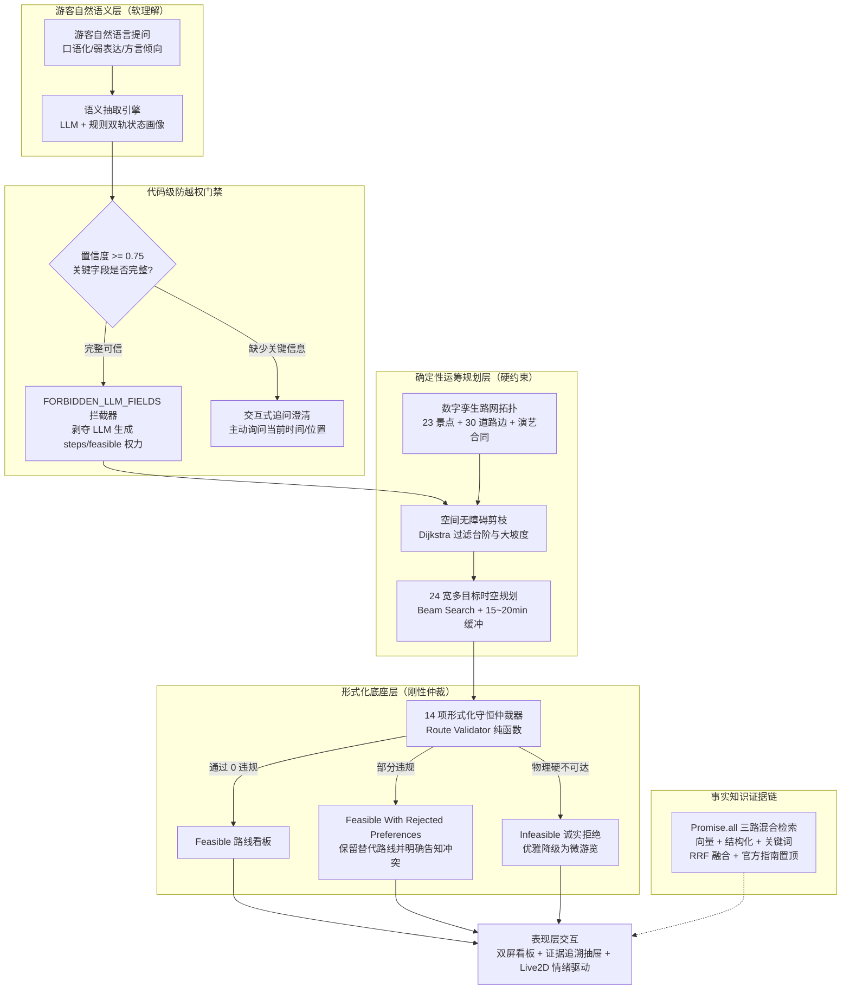

# 00_项目总览：灵小禅 · 灵山胜境可信文旅决策智能体

> **文档范围**：本项目总览系统性阐述“灵小禅”智能体的基本信息、问题定位、核心使命、软硬件架构哲学、交付成果与全局应用价值，作为 NotebookLM 理解项目全貌的基石。  
> **主要信息来源**：`README.md`、`AGENTS.md`、`docs/competition/canonical_claims.yaml`、`docs/competition/core-innovation-report.md`、`docs/competition/architecture.md`、`docs/competition/commercial_financial_model.md`。

---

## 一、项目基本信息表

| 属性 | 说明与事实口径 | 引用出处 |
| :--- | :--- | :--- |
| **项目中文全称** | **灵小禅 · 灵山胜境可信文旅决策智能体** | `docs/competition/canonical_claims.yaml` |
| **英文代号** | Lingshan AI Guide | `README.md` |
| **参赛赛道一** | **第八届全球校园人工智能算法精英大赛（AIC）· 算法创新赛 · AI+场景创新赛道**（目标：95+ 国家特等奖 / 全国金牌） | `docs/competition/aic-official-guidelines.md` |
| **参赛赛道二** | **第十一届华为 ICT 大赛 · 创新赛 · 赛题二（基于华为 AgentArts 的可信文旅决策智能体）** | `docs/competition/huawei-ict/README.md` |
| **项目当前版本** | v2.2.0-final-freeze | `package.json`, `docs/competition/canonical_claims.yaml` |
| **核心工程技术栈** | 前端：React 19 + TypeScript + Vite + PixiJS / Live2D 主后端：Node.js v20+ / Express + TypeScript + Zod 算法与微服务：Python 3.10+ (ChromaDB, BAAI/bge-large-zh-v1.5, Edge-TTS) | `README.md`, `backend/package.json` |
| **落地试点对象** | 国家 5A 级景区 · 无锡灵山胜境（占地约 30 公顷，核心节点 23 个，登记道路边 30 条） | `data/route/spots.json`, `data/route/edges.json` |

---

## 二、项目核心使命与范式跃迁 (Mission & Paradigm Shift)

### 2.1 传统文旅 AI 的根本困局：“只会背书，不会带路”
在当前文旅数字化与智慧景区建设中，95% 以上的人工智能导览产品本质上只是“套壳聊天机器人”或“语音版大百科”。当游客仅询问“灵山大佛有多高”、“五印坛城门票多少”等单点静态事实时，通用大语言模型（LLM）尚可应对；但一旦进入真实的景区游览现场，游客面临的几乎全是由**空间拓扑、身体机能、刚性时刻表与时间预算**构成的复杂多约束决策问题：

> **典型游客口语提问**：  
> *“我带腿脚不方便的妈妈，推着轮椅，现在在景区正门，总共只有 3 小时，非常想看两点的《吉祥颂》演出，中间想简单吃个素斋，应该怎么安排才不会迟到，又不用走台阶？”*

面对这一真实需求，传统大模型与传统电子导游方案暴露出三重致命翻车盲区：
1. **物理常识与空间拓扑盲区**：大模型受限于纯文本自回归概率生成，对物理世界没有“米数”、“坡度”、“台阶”概念，极其容易把轮椅游客引导至百级台阶或陡坡，导致安全事故；
2. **时空动态演艺与赶场错配**：只知演出 14:00 开演，却完全忽略入场安检（需提前 15~20 分钟）、散场人群拥堵、以及跨区域步行耗时，导致游客飞奔赶场却被拒之门外；
3. **事实口误与过度迎合编造**：通用模型存在生成幻觉，为了“讨好游客”，在时间严重不足（例如剩余 20 分钟）时仍胡乱编造一条不可执行的路线，造成游客体力透支和行程崩溃。

### 2.2 灵小禅的核心技术哲学：“软硬解耦、各司其职”
灵小禅彻底摒弃了“把路线规划全部交给大语言模型生成”的脆弱路线，在业内首次提出并确立了**“软硬双引擎解耦”**的可信文旅决策架构：

- **语义软理解归大模型（LLM）**：专门负责游客口语意图解析、13 维时空状态画像抽取、文化历史温度讲解与数字人情绪驱动；
- **时空硬规划归运筹算法（OR）**：基于数字孪生路网拓扑，通过 Dijkstra 无障碍图搜索、24 宽 Beam Search 时空推演与 14 项形式化守恒仲裁，算出每一米的真实距离、每一个台阶的阻抗与每一分钟的时间守恒；
- **核心准则**：**大模型可以理解需求并组织文案，但绝无权力跨过物理约束替游客决定路线的可行性！**

---

## 三、系统面向的用户群体与应用场景

灵小禅面向文旅行业“游客端”、“运营端”与“安全应急端”提供多模态赋能：

1. **普通大众游客**：
   - 自然语言景点导览与文化典故互动（支持流式响应与语音讲解）；
   - 根据入园时间、兴趣偏好与演艺时间表，一键获取最顺畅的游览路线；
   - 随身携带的高德/百度实景地图调起，所见即所得。
2. **银发族与特殊行动能力群体（适老化与无障碍）**：
   - 自动识别“轮椅”、“老人步速缓慢”、“婴儿推车”等脆弱人群画像；
   - 强制启用无障碍空间阻抗过滤，彻底剔除陡坡、栈道和梯级；
   - 在时间不足时主动提示避坑，守护老人身体耐力极限。
3. **景区运营管理人员**：
   - 知识库动态热更新：支持 TXT、DOCX、XLSX 文件的上传、向量分块重构与官方指南优先级调整；
   - 游客心声与情感审计大屏：基于对话 Trace 进行负面情绪预警与热点游览偏好统计；
   - 华为 AgentArts 工具流调试面板：直观监控多工具调度耗时与参数。
4. **景区大型活动与安全指挥人员（SkyGuard 原型）**：
   - 针对黄金周、法会及重大演艺活动的人员密集场所，提供“人群感知—风险评估—容量约束规划—15 类硬约束独立校验—四态状态机”闭环的疏散辅助决策。

---

## 四、核心交付成果与量化指标摘要

灵小禅已完成全栈工程代码落地与严格可复现评测，所有核心指标均有代码、原始数据及评测报告支撑：

| 评估维度 | 指标项 | 官方权威数值 / 实测表现 | 证据文件与来源 |
| :--- | :--- | :--- | :--- |
| **事实问答基线** | 50 题 Fact Contract 权威基线 | **96.0% (48/50)** 通过率，Recall 0.970，时延 3027ms | `evaluation/results/baseline_20260917_020000/report.md` |
| **检索组件贡献** | 7 组完整受控消融实验 | **Full Retrieval 观察值 98.0%**；重排模块贡献 **+8.0%** | `evaluation/results/ablation_20260917_013925/report.md` |
| **状态画像理解** | 13 维状态画像确定性抽取 | **100.0% (40/40)** 槽位准确率，关键缺失识别率 100% | `evaluation/results/scene/scene_benchmark_v1.json` |
| **物理路线合规** | 60 组边界压力与极端路线测试 | **100.0% (60/60)** 形式化合规，**物理硬违规恒为 0 次** | `evaluation/results/route/route_validator_v1.json` |
| **边缘计算性能** | 4 核 8G 纯运筹规划接口压测 | **202.4 QPS** 吞吐量，**P95 = 13.4ms**，0 错误率 | `evaluation/results/stress_test/locust_report.md` |
| **商业运维成本** | 单景区轻量化部署年综合成本 | **< 1.5 万元 / 年**，测算 **3~6 个月** 收回 ROI | `docs/competition/commercial_financial_model.md` |
| **现场预调研** | 文旅痛点探索性预调研 ($n=50$) | **82%** 曾错过演出，**66%** 遭遇无障碍阻断，**90%** 愿使用 | `竞赛汇报与文档材料包/05_现场演示与用户调研/` |

---

## 五、项目知识体系导航指南

为了方便在 NotebookLM 中展开高效率的多维度探索与交叉提问，本知识库已按照严谨的软件工程与学术竞赛标准拆分为以下九大专题文档：

- **[01_项目背景与需求.md](file:///notebooklm_materials/01_项目背景与需求.md)**：深入剖析文旅三大行业痛点、探索性调研数据与真实场景刚性需求；
- **[02_系统总体架构.md](file:///notebooklm_materials/02_系统总体架构.md)**：五层解耦架构、全链路数据流拓扑、数字孪生路网模型与华为 AgentArts / SkyGuard 业务域边界；
- **[03_核心技术与实现原理.md](file:///notebooklm_materials/03_核心技术与实现原理.md)**：数学公式与伪代码详析：Promise.all 三路检索 + RRF 融合、倒排逆推时空抽取、Dijkstra + Beam Search、14 项形式化验证；
- **[04_功能模块与业务流程.md](file:///notebooklm_materials/04_功能模块与业务流程.md)**：双屏表现层、四态决策状态机（feasible/rejected/clarify/infeasible）、运营后台与代码实现映射；
- **[05_实验数据与性能评测.md](file:///notebooklm_materials/05_实验数据与性能评测.md)**：基线实验、消融实证、状态抽取基准、路线边界验证与 Locust 压力测试的原始记录与评测口径；
- **[06_创新点与项目成果.md](file:///notebooklm_materials/06_创新点与项目成果.md)**：五大差异化核心创新、官方 100 分赛题标准对标与财务 ROI 商业变现模型；
- **[07_项目不足与未来规划.md](file:///notebooklm_materials/07_项目不足与未来规划.md)**：坦诚披露路网估算现状（23节点30条边estimated）、AgentArts 未真机联调现状、三阶推广路线；
- **[08_PPT制作素材.md](file:///notebooklm_materials/08_PPT制作素材.md)**：专为答辩演讲设计的 14 页金牌分镜规范、高频专家 QA 攻防卡与原生视觉素材清单；
- **[09_资料来源与证据索引.md](file:///notebooklm_materials/09_资料来源与证据索引.md)**：FACT-01 至 FACT-14 事实台账索引、代码行号与证据链全量对齐矩阵。
