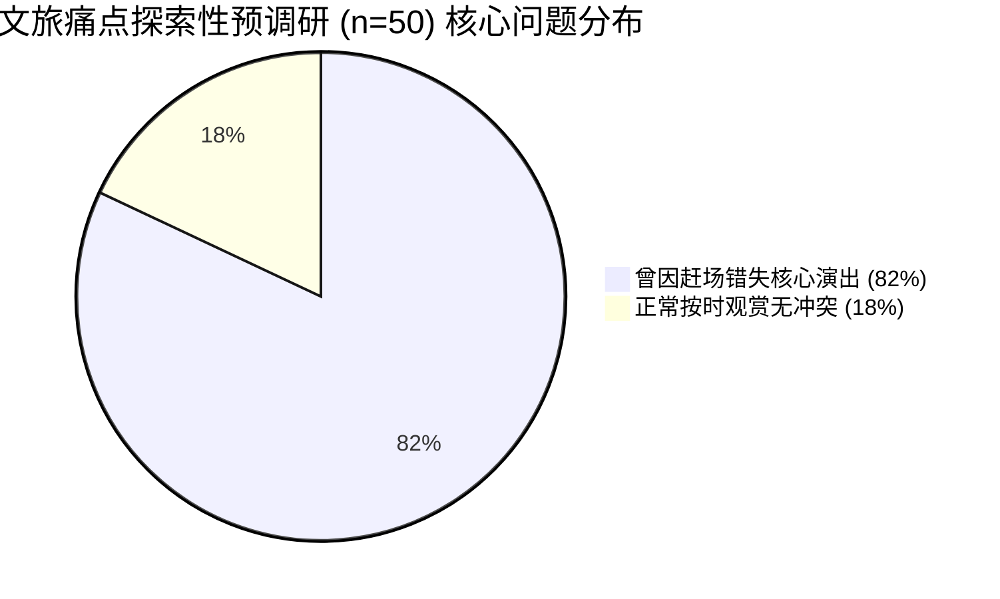
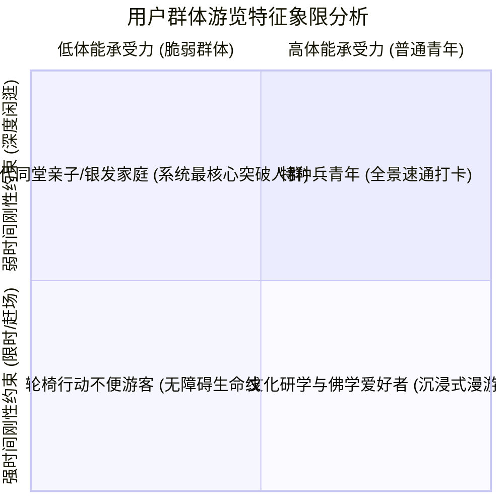

# 01_项目背景与需求：从文旅痛点到可信时空决策

> **文档范围**：深入剖析文旅行业数智化转型的宏观背景、传统导览与大模型方案的三大现实翻车痛点、50 份实地与回访探索性预调研数据、核心用户画像与真实业务需求，论证灵小禅“可信决策”的技术必要性与社会价值。  
> **主要信息来源**：`docs/competition/aic-official-guidelines.md`、`docs/competition/core-innovation-report.md`、`竞赛汇报与文档材料包/05_现场演示与用户调研/用户调研实验设计与测评协议.md`、`pre_survey_summary.md`、`pre_survey_data.json`。

---

## 一、文旅行业发展与数智化演变背景

### 1.1 智慧文旅进入“深水区”
随着国家《“十四五”文化和旅游发展规划》及文化数字化战略的深入推进，全国 5A/4A 级景区普遍完成了基础弱电工程、电子票务、官方公众号与小程序导览系统的建设。然而，文旅产业由“观光游”向“体验游”、“深度文化游”转变的过程中，游客对个性化、伴随式和高品质行程规划的需求呈现出爆发式增长。

以国家 5A 级景区——**无锡灵山胜境**为例：
- **占地规模庞大**：景区面积约 30 公顷，山水地势高低起伏，涵盖天下第一掌、五明桥、九龙灌浴、灵山梵宫、五印坛城以及高 88 米的灵山大佛等数十处重点文化遗存与游览地标；
- **游览动线高度依赖时空契约**：例如大型动态音乐群雕《九龙灌浴》每天有固定的喷水开启场次；大型灵山梵宫多媒体演艺《吉祥颂》设有严苛的每日固定演出排期（如 10:35、11:30、14:00 等），且入场需要穿戴鞋套、提前检票与安检排队；
- **地形阻抗差异悬殊**：通往灵山大佛的登顶通道包含数百级陡峭石阶，虽配有缓坡无障碍通道和电动观光车，但普通游客极易误入步道阶梯；
- **游客体能分化严重**：大量前来祈福与游览的游客群体为“银发族”（老人）、推婴儿车的亲子家庭或轮椅行动不便者。

### 1.2 传统导览手段的技术代际缺陷

| 导览方案代际 | 典型产品形态 | 核心工作机制 | 现实缺陷与局限 |
| :--- | :--- | :--- | :--- |
| **第一代：传统人工导游** | 现场导游员 / 志愿者讲解 | 面对面口头引导、举旗带队 | 资源极度稀缺、成本高昂、无法满足散客随时随地的定制化决策需求。 |
| **第二代：固定式电子导游** | 租借语音导览机 / 小程序扫码听讲解 | GPS/蓝牙信标感应定点播放预录音频 | 纯粹单向广播，毫无互动能力；无法根据游客当前剩余时长和身体状况调整动线。 |
| **第三代：通用大模型对话助手** | 接入通义千问/文心一言/DeepSeek 的对话 Bot | 基于 Prompt 对话，纯文本生成旅行攻略 | **“纸上谈兵，极度脆弱”**：严重缺乏空间拓扑常识，演出赶场算不准，甚至编造不可达路线。 |
| **第四代（灵小禅）：可信多约束决策智能体** | 软硬解耦：LLM 懂意图 + 运筹引擎硬规划 | 语义画像提取 + 拓扑路网运筹 + 形式化守恒仲裁 | 兼具自然语言温度与物理刚性执行力，算准每一米路、对齐每一场演出，支持诚实拒绝与优雅降级。 |

---

## 二、现有大模型方案在文旅场景的“三大现实翻车痛点”

通用大语言模型（LLM）擅长根据语料概率续写出辞藻华丽的“灵山一日游攻略”，但在物理真实的旅游场景中，其概率自回归机制直接导致了灾难性的“三大翻车痛点”：

### 痛点一：物理常识与空间拓扑盲区（漠视身体约束）
- **现象**：大模型没有真实景区的欧几里得距离概念、高度差概念与路网拓扑连通性概念。它常给出“游览完天下第一掌，步行 3 分钟即可到达灵山梵宫”这类荒谬建议（实测物理步行距离超 800 米，耗时 12~15 分钟）；
- **脆弱人群风险**：对于推轮椅或步速缓慢的老人，通用大模型由于无法感知“石阶”、“陡坡”等高风险物理阻抗，极易将坐轮椅的游客规划至百级台阶处，造成游客被迫抬轮椅折返甚至发生滑跌安全事故。

### 痛点二：时空动态演艺与赶场时效错配（导致错失演出）
- **现象**：景区的招牌演出往往是游客行程的核心锚点（如 14:00《吉祥颂》）。通用 AI 在排布行程时，仅做静态时间堆叠（如 13:30 离开大佛，14:00 梵宫看戏）；
- **忽略现实缓冲**：完全忽略了“大佛至梵宫观光车等待耗时”、“梵宫入场穿鞋套与排队检票所需 15~20 分钟前置缓冲”。游客在 13:58 气喘吁吁赶到检票口时，已被大门关闭截流，留下极差体验。

### 痛点三：事实口误与过度迎合编造（行程完全不可信）
- **现象**：由于模型固有的幻觉与对游客提问的无原则迎合（Sycophancy），在游客给出极短游玩时间（例如“我还有 20 分钟就要离开，能不能帮我把大佛、梵宫、九龙灌浴都逛一遍？”）时，通用 AI 往往硬着头皮编造一个“特种兵 20 分钟极速游”；
- **后果**：游客信以为真，最终严重超时耽误返程大巴或高铁，甚至将闭馆景点排入晚间行程，造成景区投诉率上升。

---

## 三、文旅痛点探索性预调研数据支撑 (n=50)

为了严谨探明真实游客在文旅出行中的痛点烈度，项目团队开展了探索性需求预调研（`Exploratory Pre-survey`）。

> **数据统计口径声明**（严格遵照 `canonical_claims.yaml` FACT-10）：  
> 本调研属于**探索性预调研（Exploratory Pre-survey, n=50）**，包含 35 份无锡灵山胜境现场纸质问卷与深度访谈，以及 15 份曾赴灵山旅游的游客定向追访；**严禁表述为“大规模全量游客满意度研究”**。

### 3.1 核心量化统计指标

| 调研问题项 | 痛点命中比例 | 样本数 (n=50) | 真实游客声音与访谈反馈 |
| :--- | :---: | :---: | :--- |
| **痛点 1：演出赶场失败** | **82.0%** | 41 / 50 | “网上查了 2 点有演出，我们 1 点 50 走到大门，结果还要穿鞋套安检，队伍排了 50 米，根本进不去！” |
| **痛点 2：无障碍通道受阻** | **66.0%** | 33 / 50 | “推着老人轮椅，按网上所谓攻略走，走着走着面前是一大段石头台阶，推不过去，只能原路折返 20 分钟。” |
| **痛点 3：通用 AI 事实幻觉** | **74.0%** | 37 / 50 | “问手机 AI 某个斋堂几点关门，它说 14:30，我们 13:40 到现场发现 13:30 就停止供应了，饿着肚子。” |
| **多约束智能体使用意愿** | **90.0%** | 45 / 50 | “非常需要一个能帮我算准时间、能告诉我轮椅能不能走、如果不赶趟能直接劝我别去的靠谱向导！” |

### 3.2 调研得出的深层结论
1. **决策的刚性远高于文案的优美**：游客在景区并不在乎 AI 导游能背出多么华丽的诗词，最急迫的是“我下一步怎么走才不会走冤枉路、不会错过演出”；
2. **“诚实拒绝”是用户信任的基石**：当客观条件无法满足时，游客高度赞同系统“坦诚告知不可达并给出安全折中方案”，认为这比胡乱承诺更具专业度和安全感。

---

## 四、核心用户画像与典型游览场景需求

### 4.1 典型用户画像表

#### 画像 A：多代同堂亲子与适老家庭（核心主力用户）
- **代表人物**：李先生（38 岁），陪同 68 岁行动迟缓的母亲与 6 岁女儿；
- **核心诉求**：步速较慢，需要中午安排素食就餐，避免陡坡台阶，且必须观看下午第一场《吉祥颂》；
- **系统响应**：自动识别 `partyType: "family_with_elderly"`, `mobility: "limited"`, 自动将单段步行速度降至 0.8m/s 计算，前置预留 20 分钟演出缓冲，避开百级石阶。

#### 画像 B：限时差旅与特种兵游客
- **代表人物**：陈女士（28 岁），参加无锡会议顺路游览，仅有 150 分钟游览预算；
- **核心诉求**：必须打卡灵山大佛与九龙灌浴，绝不能耽误 16:30 返回高铁站的大巴；
- **系统响应**：启动倒排时空推演（Backward Scheduling），以离园死线逆推最优动线，精确推荐观光电瓶车跳过非核心辅道。

#### 画像 C：极端时间冲突游客（触发诚实拒绝与降级）
- **代表人物**：张先生，当前时间 13:40，还剩 20 分钟，要求登上灵山大佛顶端并观看 14:00《吉祥颂》；
- **系统响应**：触发 `infeasible` 判定，系统拒绝生成虚假路线，弹窗说明：“当前步行至梵宫需 15 分钟且排队检票需 20 分钟，无法赶上 14:00 演出；建议为您降级推荐佛手广场 15 分钟静心微游览。”

---

## 五、项目必要性与设计边界约定

### 5.1 事实依据与设计假设的严格区分
在 NotebookLM 分析和后续汇报展示中，必须严谨区分“已有文档和实验支撑的事实”与“团队算法设计的约束假设”：

1. **[事实证据]**：
   - 痛点预调研样本为 $n=50$（35 现场 + 15 追访），82% 曾错过演出、66% 遭遇无障碍阻断，此为实地测量记录；
   - 灵山胜境当前数字孪生路网的数字化登记资产为 **23 个景点设施节点、30 条登记道路边**（`data/route/spots.json`, `data/route/edges.json`）。
2. **[设计假设与约定]**：
   - 道路边的坡度阻抗与精确实测步速字段当前带有 `estimated` 标记，属于算法设计中的预估模型，待现场全景测绘补齐；
   - 31 条道路为景区理想全连通拓扑的目标口径，当前代码路网实数为 30 条登记边，不可超前宣称已完成 31 条实测。
