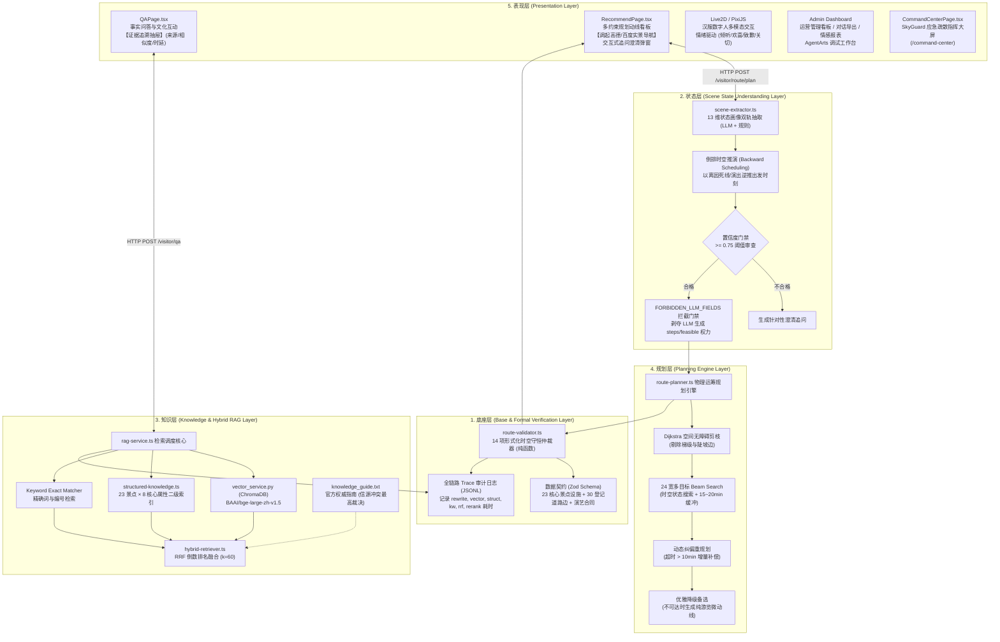
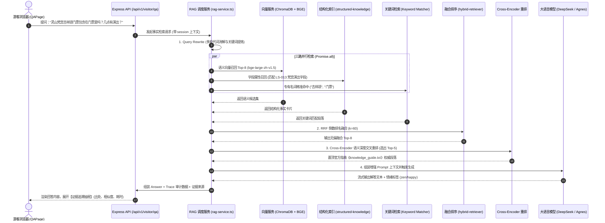
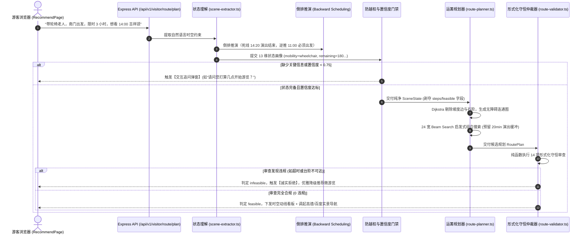

# 02_系统总体架构：五层解耦与可信闭环设计

> **文档范围**：全面解析灵小禅智能体的系统级全景架构、五层工程解耦机制、软硬双引擎协同原理、全链路数据流转图谱、数据契约规范，以及华为 AgentArts 工具体系与 SkyGuard 安全应急子系统的集成架构。  
> **主要信息来源**：`README.md`、`AGENTS.md`、`docs/competition/architecture.md`、`docs/competition/canonical_claims.yaml`、`backend/src/app.ts`、`backend/src/services/`、`docs/competition/huawei-ict/integration.md`、`docs/skyguard/README.md`。

---

## 一、系统五层解耦全景架构图

灵小禅彻底告别了传统“大模型端到端一把抓”的脆弱黑盒设计，采用分层明确、职责自治、单向依赖的**五层工程解耦架构**：



---

## 二、双引擎职责分离矩阵 (LLM vs. Operations Research)

为了从根本上消除 AI 幻觉引发的文旅翻车事故，系统确立了“**软硬解耦、各司其职**”的技术契约边界：

| 决策维度与业务问题 | 负责引擎 | 计算范式 | 判定依据与交付物 | 绝对禁止事项 |
| :--- | :--- | :--- | :--- | :--- |
| **游客口语意图解析** | 大语言模型 (LLM) | 语义理解 (Soft) | 结构化 13 维 Scene State 字典，置信度打分 | 严禁直接输出路线步骤 (`steps`) |
| **文化历史温度讲解** | 大语言模型 (LLM) | 自然语言生成 (Soft) | 结合文化知识的文雅解答、Live2D 情绪表情映射 | 严禁在缺乏检索证据时凭空捏造事实 |
| **空间无障碍可达性** | 运筹引擎 (Dijkstra) | 图论拓扑计算 (Hard) | 过滤台阶与大坡度，输出无障碍连通子图 | 严禁将轮椅游客放行至阶梯路段 |
| **演艺场次入场缓冲** | 运筹引擎 (Beam Search) | 时空窗口运筹 (Hard) | 强制注入 15~20 分钟前置安检排队与鞋套缓冲 | 严禁在开演压哨甚至迟到时排入行程 |
| **物理时间预算守恒** | 形式化仲裁器 (Validator) | 严格代数守恒 (Hard) | $\sum t_{walk} + \sum t_{visit} + \sum t_{wait} \le T_{budget}$ | 严禁超时；超时必须诚实拒绝 (`infeasible`) |
| **不可行时的降级解释** | LLM + 业务模板 | 友好人本交互 (Soft) | “因梵宫检票需提前20分钟，为您推荐佛手广场微游览” | 严禁向普通游客展示晦涩的底层错误码 |

---

## 三、核心业务数据流转全景 (End-to-End Data Flows)

### 3.1 事实问答流 (Fact QA Pipeline)


### 3.2 路线决策流 (Multi-Constraint Route Planning Pipeline)


---

## 四、数字孪生路网拓扑模型与数据契约

灵小禅的物理时空推演完全建立在景区的**数字孪生路网模型（Digital Twin Graph）**之上：

### 4.1 核心资产规模与当前口径
- **节点资产（`data/route/spots.json`）**：严格登记 **23 个核心景点与设施节点**（南门 `south_gate`、天下第一掌 `LS-008`、九龙灌浴 `LS-006`、灵山梵宫 `LS-013`、灵山大佛 `LS-010` 等）；
- **路网边资产（`data/route/edges.json`）**：严格登记 **30 条当前连通道路边**（含物理米数 `distance_m`、基准步行时间 `walk_minutes`、无障碍标识 `accessible`、信源置信度 `confidence: "estimated"`）；
- **演艺时刻合同（`data/route/performances.json`）**：严格登记 2 大招牌演艺（九龙灌浴喷泉时刻表、梵宫《吉祥颂》演出排期与持续时长 20 分钟）；
- **配套设施合同（`data/route/facilities.json`）**：登记电瓶车观光站、无障碍服务亭、医务室等关键点位。

> **⚠️ 事实核验边界**（严格对齐 `canonical_claims.yaml` FACT-07）：  
> 当前路网登记实数为 **23 节点、30 条边**，全部边属性带有 `estimated`（预估）标识，暂未注入现场高精实测坡度字段。31 条道路为景区远期全覆盖目标口径，在正式完成现场工程测绘前，**严禁在文档中声称“31 条实测道路及坡度建模已完成”**。

---

## 五、华为 ICT AgentArts 工具体系与 SkyGuard 子系统

### 5.1 华为 AgentArts 工具体系架构 (`/api/v1/agentarts/tools/*`)
为了适配第十一届华为 ICT 大赛创新赛赛题二，系统将内部核心决策能力封装为标准的 OpenAPI / AgentArts HTTP 工具集：

```text
┌────────────────────────────────────────────────────────────────────────┐
│                   华为 AgentArts 平台编排工作流                        │
└───────────────────────────────────┬────────────────────────────────────┘
                                    │ Header: X-API-Key: {TOOL_API_KEY}
┌───────────────────────────────────▼────────────────────────────────────┐
│ 灵小禅 AgentArts 网关入口 (/api/v1/agentarts/tools/*)                  │
├─────────────────┬──────────────────┬─────────────────┬─────────────────┤
│ 1. 场景提取工具  │ 2. 混合检索工具  │ 3. 路线规划工具 │ 4. 形式化校验   │
│   scene_extract │   knowledge_ret  │   route_plan    │   route_verify  │
├─────────────────┴──────────────────┴─────────────────┴─────────────────┤
│ 5. 综合决策编排工具 (/api/v1/agentarts/tools/decide) (本地参考实现)    │
└────────────────────────────────────────────────────────────────────────┘
```
- **安全鉴权**：工具接口必须校验 `X-API-Key`；后台调试面板统一通过管理员 JWT 鉴权免密调试；
- **三种状态界定**：代码中的 5 个 HTTP 工具服务、本地参考编排脚本（`agentarts-local.ts`）、以及 AgentArts 平台真实工作流是三种完全不同的工程状态。在平台工作空间未分配前，严禁宣称平台端到端联调完成。

### 5.2 SkyGuard 独立安全决策系统（应急疏散辅助原型）
在 `feat/skyguard-migration` 分支中，系统在同一架构底座下扩展出了**独立的安全业务域**：
- **领域模型隔离**：定义了独立的区域（Zone）、通道（Corridor）、出口（Exit）、观测（Observation）与事件（Incident）模型，与旅游业务完全解耦；
- **算法模型**：采用**时间扩展最小费用最大流（Time-Expanded Min-Cost Flow）**算法，在通道容量与出口流速硬约束下求解最优疏散动线；
- **15 类硬约束独立校验器**：独立于规划器运行，绝不信任规划器自报的“成功”；
- **四态决策状态机**：`NORMAL`（正常）、`REROUTE`（分流预警）、`DEGRADED`（降级观测）、`REJECT`（数据失真拒绝发布）；
- **指挥大屏**：前端独立提供 `/command-center` 深色大屏界面，展示人流热力与应急状态。

---

## 六、硬件部署与算力配置规格 (Edge Computing Node)

灵小禅高度强调“轻量工程交付”，杜绝高昂的大规模集群依赖：
- **边缘计算节点规格**：单台轻量级云服务器或现场工业级工控机，**4 vCPU (Intel Xeon @ 2.50GHz) + 8GB 内存**；
- **计算隔离设计**：运筹规划核心下沉至 Node.js `worker_threads` 独立线程池运行，确保 200 并发图计算不阻塞 Web 异步 I/O；
- **常驻内存与冷启动**：拓扑路网内存占用仅 **35 KB**，后端服务冷启动耗时 $< 1.2$ 秒，RSS 内存常驻低于 320 MB。
