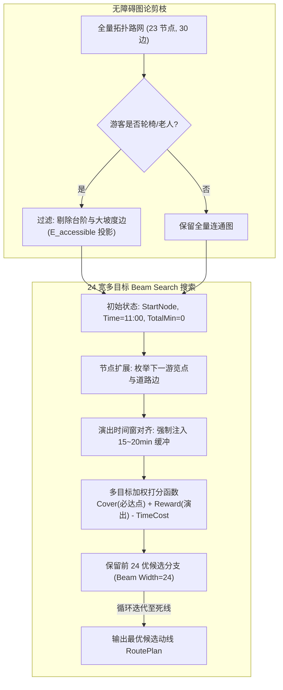
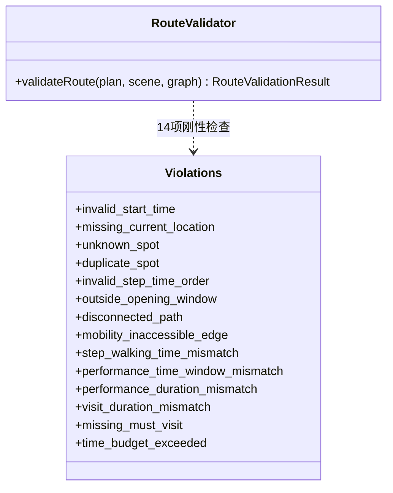

# 03_核心技术与实现原理：算法、公式与代码机制剖析

> **文档范围**：本项目最核心的技术文档。深度解密三路混合检索与 RRF 融合算法、13 维时空场景状态抽取与防越权门禁、Dijkstra + 24 宽 Beam Search 运筹规划引擎、14 项形式化时空守恒仲裁器，以及 SkyGuard 容量约束时空网络流算法。提供严谨数学公式、伪代码和关键代码实现。  
> **主要信息来源**：`backend/src/services/rag-service.ts`、`backend/src/services/retrieval/hybrid-retriever.ts`、`backend/src/services/scene/scene-extractor.ts`、`backend/src/services/route/route-planner.ts`、`backend/src/services/route/route-validator.ts`、`backend/src/services/safety/planning/min-cost-flow.ts`。

---

## 核心技术一：Promise.all 三路混合检索与 RRF 倒数排名融合

### 1.1 技术解决的痛点
在文旅知识检索中，单一检索模式均存在严重局限：
- **纯向量检索（Vector Only）**：对专有名词、特定票价数字、演出场次编号等不敏感，极易发生“同义词漂移”（例如询问“门票价格”，返回大段“门票历史演进”）；
- **纯结构化检索（Structured Only）**：只能精准查询预定义的固定属性（如开放时间、票价），对口语化、开放式历史典故毫无泛化能力；
- **纯关键词检索（Keyword Only）**：依赖字面重合，面对游客口语化表述（如“大佛脚下的那只大手掌”）无法联想到“天下第一掌”。

### 1.2 基本原理与数学公式
灵小禅采用基于 `Promise.all` 的三路并行异步检索机制，并在候选集融合阶段引入**倒数排名融合算法（Reciprocal Rank Fusion, RRF）**。

#### RRF 数学公式定义
对于任一知识候选块 $d$，其在所有检索通道 $C = \{\text{vector}, \text{structured}, \text{keyword}\}$ 中的综合得分计算如下：

$$RRF(d) = \sum_{c \in C} \frac{\mathbb{I}(d \in R_c)}{k + r_c(d)}$$

- 其中 $k$ 为平滑常数，本项目在代码中严格固化设定为 **$k = 60$**（广泛公认的鲁棒最优参数）；
- $r_c(d) \in [1, K]$ 表示候选文档 $d$ 在通道 $c$ 中的排名位次（Rank）；
- $\mathbb{I}(\cdot)$ 为指示函数，若候选文档未在该通道召回，则其贡献值为 0。

```mermaid
flowchart LR
    Q[游客 Query: 吉祥颂门票与场次] --> Rewriter[Query Rewrite 重写模块]
    Rewriter --> Fork{Promise.all\n三路并行并发}
    
    Fork -->|通道 1| V[向量检索: ChromaDB\nBAAI/bge-large-zh-v1.5\n召回 Top-8]
    Fork -->|通道 2| S[结构化检索: 23 景点\n属性倒排二级索引\n召回 Top-8]
    Fork -->|通道 3| K[关键词检索: 精确词\nBM25 / Jaccard 匹配\n召回 Top-8]
    
    V & S & K --> RRF[RRF 融合算子 (k=60)\n去重 + 倒数加权积分]
    RRF --> CE[Cross-Encoder 重排器\n(预留 Top-5 深度打分)]
    CE --> GuideJudge{信源冲突仲裁器}
    GuideJudge -->|存在官方指南| Override[置顶官方指南\nknowledge_guide.txt]
    GuideJudge -->|无冲突| Context[构建动态 Prompt Context]
    Override --> Context
```

### 1.3 核心实现代码（TypeScript）
代码位于 `backend/src/services/retrieval/hybrid-retriever.ts` 与 `rag-service.ts`：

```typescript
// backend/src/services/retrieval/hybrid-retriever.ts
export function fuseCandidates(
  channels: Record<RetrievalChannel, RetrievalCandidate[]>,
  rrfK = 60,
): FusionResult {
  const fused = new Map<string, FusedCandidate>();

  for (const channel of ['vector', 'structured', 'keyword'] as RetrievalChannel[]) {
    for (const candidate of channels[channel]) {
      const contribution = 1 / (rrfK + candidate.rank);
      const current = fused.get(candidate.dedupeKey);
      if (current) {
        current.rrfScore += contribution;
        if (!current.channels.includes(channel)) current.channels.push(channel);
        continue;
      }
      fused.set(candidate.dedupeKey, {
        ...candidate,
        channels: [channel],
        rrfScore: contribution,
      });
    }
  }

  const ranked = [...fused.values()].sort((left, right) =>
    right.rrfScore - left.rrfScore
    || left.rank - right.rank
    || left.canonicalId.localeCompare(right.canonicalId),
  );
  return { candidates: [...fused.values()], ranked, channelCounts, rrfK };
}
```

```typescript
// backend/src/services/rag-service.ts: 542-543 行
const [vector, structured, keyword] = await Promise.all([vectorPromise, structuredPromise, keywordPromise]);
const fusion = fuseCandidates({ vector, structured, keyword });
```

---

## 核心技术二：13 维时空场景状态理解与防越权门禁

### 2.1 13 维状态画像字段设计
为了将口语化表达转化为运筹引擎可求解的确定性数学规划输入，系统定义了 13 维强类型场景状态画像字典：

| 字段名 | 类型 | 说明与典型值 | 是否关键必选 |
| :--- | :--- | :--- | :---: |
| `currentLocation` | string | 当前所处地标 ID（如 `south_gate`, `LS-008`） | **是** |
| `currentTime` | string (HH:mm) | 当前开始游览的时间（如 `11:00`） | **是** |
| `remainingMinutes` | number | 游览总时间预算（分钟，如 `180`） | **是** |
| `mobility` | enum | 行动能力：`normal` / `limited` / `wheelchair` | **是** |
| `partyType` | string | 同行人员画像：如 `family_with_elderly`, `couple` | 否 |
| `mealRequested` | boolean | 是否需要在动线中安排素斋就餐 | 否 |
| `interests` | string[] | 兴趣标签列表：`['buddhism', 'architecture']` | 否 |
| `mustVisitSpotNames` | string[] | 必去景点中文名称列表 | 否 |
| `mustVisitSpotIds` | string[] | 必去景点标准编码（如 `['LS-010', 'LS-013']`） | 否 |
| `preferredPerformanceNames` | string[] | 偏好观看的演出名称（如 `['吉祥颂']`） | 否 |
| `preferredPerformanceIds` | string[] | 偏好演出的标准 ID | 否 |
| `preferredPerformanceTimes` | map | 指定演出的期望场次（如 `{"LS-013": "14:00"}`） | **是**（若指定演出） |
| `visitedSpotIds` | string[] | 当天已打卡参观过的景点（防止重复引导） | 否 |

### 2.2 倒排时空约束推演 (Backward Scheduling)
真实游客常以“死线”或“演出场次”为锚点表达需求。例如：“*我现在只有 3 小时，打算看下午 2 点（14:00）的吉祥颂，请问怎么安排？*”  
如果顺排计算，系统无法知晓游客当前是几点。系统内置了**倒排时空推演算法**：
1. **死线计算**：目标演出《吉祥颂》14:00 开演，时长 20 分钟，散场结束时刻为 $T_{end} = 14:20$；
2. **入场与前置缓冲**：强制注入 20 分钟检票排队缓冲，最晚到达梵宫检票口时刻为 $13:40$；
3. **预算逆推**：游客总时间预算为 180 分钟（3 小时），系统逆推计算游客当前出发时刻：
   $$T_{current} = T_{perf\_start} - T_{budget\_before\_perf} \implies 11:00$$
4. 若推演时刻超出合理游览窗口或出现自相矛盾，系统判定关键信息缺失，进入交互式追问澄清流程。

### 2.3 代码级防越权门禁（`FORBIDDEN_LLM_FIELDS`）
在 `backend/src/services/scene/scene-extractor.ts` 中，通过代码硬编码拦截，**彻底剥夺大模型输出路线步骤的权力**：

```typescript
// backend/src/services/scene/scene-extractor.ts: 69-75 行
const FORBIDDEN_LLM_FIELDS = [
  'steps',
  'walkingMinutes',
  'totalMinutes',
  'feasible',
  'outcome',
] as const;
```
系统要求大模型输出 JSON 格式时只允许提取事实属性；即使模型在输出中恶意编造了 `feasible: true` 或生成了 `steps` 数组，门禁解析器会直接将此类字段强行剥离丢弃，杜绝大模型“越权替算法宣称可行”。

---

## 核心技术三：确定性拓扑运筹规划引擎 (Dijkstra + 24-Beam Search)

### 3.1 空间无障碍剪枝：Dijkstra 阻抗过滤
针对特殊体能与轮椅游客（`mobility === 'wheelchair'` 或 `limited`），规划引擎首先对数字孪生拓扑图 $G=(V, E)$ 进行子图投影剪枝：

$$E_{accessible} = \{ e \in E \mid e.accessible = \text{true} \land e.slope \le \theta_{threshold} \land e.has\_stairs = \text{false} \}$$

若游客属于轮椅用户，所有包含台阶（Stairs）或坡度超过阈值（如 $> 2.5^\circ$）的边被永久剪除。随后在无障碍子图 $G' = (V, E_{accessible})$ 上运行 Dijkstra 算法，生成所有可达节点间的最短步行时间与米数距离矩阵。



### 3.2 24 宽多目标 Beam Search 时空搜索
为了在指数级组合爆炸的旅行商问题（TSP）中实现毫秒级快速收敛，规划器采用 **束搜索（Beam Search，束宽 $B=24$）**：
1. **状态定义**：每个搜索状态为一个四元组 $S_t = (node, current\_time, visited\_set, route\_steps)$；
2. **启发式综合打分函数**：
   $$\text{Score}(S_t) = w_1 \cdot \frac{|visited \cap \text{MustVisit}|}{|\text{MustVisit}|} + w_2 \cdot \mathbb{I}(\text{PerfAttended}) + w_3 \cdot \frac{T_{visit}}{T_{total}} - w_4 \cdot \frac{T_{walk}}{T_{budget}}$$
3. **演艺缓冲硬约束**：当下一候选节点为演出场地时，必须满足入场缓冲窗口：
   $$T_{arrive} + T_{buffer} \le T_{perf\_start} \le T_{arrive} + T_{wait\_max}$$
   若 $T_{arrive} + T_{buffer} > T_{perf\_start}$，说明即使赶到也已迟到被截流，该搜索分支被剪枝器立即诛杀。

---

## 核心技术四：14 项形式化时空守恒仲裁器 (Route Validator)

### 4.1 独立仲裁架构
`route-validator.ts` 是一个**无副作用、独立运行的纯数学仲裁器**。它不参与路线生成，仅接收规划器生成的 `RoutePlan`、游客画像 `SceneState` 和数字孪生路网 `RouteGraph`，对路线进行 14 项极其苛刻的形式化代数审查。

### 4.2 14 项形式化审查规则表



| 序号 | 守恒规则编码 (`code`) | 物理含义与代数约束方程 | 违规后果与处理机制 |
| :---: | :--- | :--- | :--- |
| **1** | `invalid_start_time` | 出发时间必须满足正则 `^([01]\d\|2[0-3]):[0-5]\d$` | 拒绝生成，提示时间格式错误 |
| **2** | `missing_current_location`| 路线起点必须明确对应真实有效物理节点 | 触发澄清门禁，询问游客所在位置 |
| **3** | `unknown_spot` / `duplicate` | 途经景点必须已注册且单日行程不走回头路 | 剔除重复点位或报错 |
| **4** | `invalid_time_order` | 单步游览必须满足 $t_{arrive} \le t_{start} < t_{end}$ | 杜绝时间倒流或超光速时空穿梭 |
| **5** | `outside_opening_window` | 游览时间段必须严格落在景点开放时间窗口内 | 拦截闭馆游览计划 |
| **6** | `disconnected` | 相邻两点必须在物理拓扑图中有边相连 ($e \in E$) | 杜绝凭空飞跃非连通断头路 |
| **7** | `mobility_inaccessible_edge`| 轮椅/受限游客途经所有边必须满足 $edge.accessible == true$ | 杜绝轮椅硬闯台阶与陡坡 |
| **8** | `step_walking_time_mismatch` | 步态耗时必须与路网边的实际米数及阻抗严格一致 | 杜绝大模型随意虚报步行耗时 |
| **9** | `performance_time_mismatch` | 演出开始时间必须严格命中官方排期表 | 杜绝在没有演出的时间看戏 |
| **10**| `performance_duration_mismatch` | 演出持续时长必须等于官方合同规定值（如吉祥颂 20min） | 杜绝随意缩减演出观看时间 |
| **11**| `visit_duration_mismatch` | 景点停留时长必须满足该景点推荐的最短静观时间 | 杜绝“走马观花 0 秒打卡” |
| **12**| `missing_must_visit` | 游客指定的全部必去点集合必须 100% 被路线覆盖 | 降级为部分满足或重新规划 |
| **13**| `missing_preferred_perf` | 游客指定的演艺场次必须 100% 履约 | 降级为备选纯游览路线 |
| **14**| `time_budget_exceeded` | $\sum t_{walk} + \sum t_{visit} + \sum t_{wait} \le T_{budget}$ (时间守恒) | **诚实拒绝**，严禁超时游览 |

---

## 核心技术五：SkyGuard 容量约束时空网络最小费用流算法

在 `feat/skyguard-migration` 安全决策子系统中，针对大型演艺散场与人流密集场景，设计了**时间扩展网络（Time-Expanded Network）最小费用流模型**：

```text
min   Z = ∑ [ cost(u, v, t) · flow(u, v, t) ]
s.t.  ∑ flow(v, u, t) - ∑ flow(u, w, t+1) = demand(u, t)   (流量守恒)
      0 ≤ flow(u, v, t) ≤ Capacity(u, v)                  (通道通行能力上限)
      ∑ flow(u, Exit, t) ≤ FlowRate(Exit)                 (出口单位时间泄洪上限)
```

- **15 类硬约束独立安全校验器**：独立于规划器运行，检查通道瞬时密度是否超标（$\le 3.5 \text{人}/\text{m}^2$）、出口是否发生踩踏拥堵；
- **四态状态机（State Machine）**：
  - `NORMAL`：全域密度安全，保持常规动线引导；
  - `REROUTE`：局部通道拥堵预警，自动计算分流疏导绕行路径；
  - `DEGRADED`：摄像头感知失效或视频丢帧，降级为稳态保守观测；
  - `REJECT`：数据严重失真或全域出口瘫痪，拒绝发布任何自动路线，移交现场人工广播。
