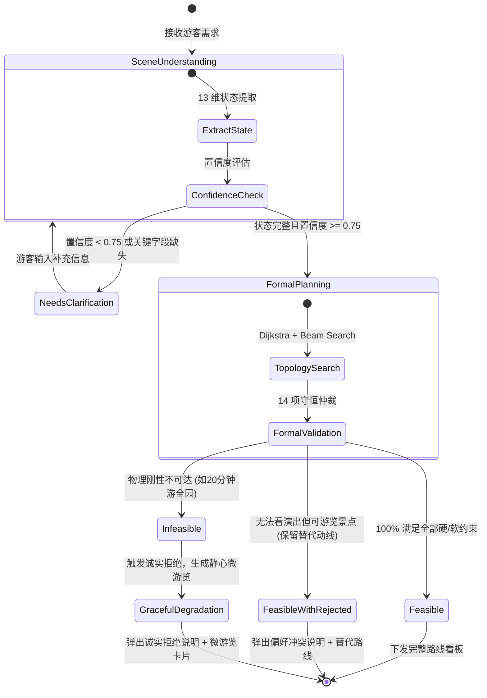

# 04_功能模块与业务流程：全功能清单与状态机流转

> **文档范围**：逐项整理灵小禅智能体面向游客端、运营端与指挥大屏的全部已实现功能、输入输出契约、业务流转状态机（四态流转）、对应的源代码文件，以及严格的功能完成度分类清单。  
> **主要信息来源**：`frontend/src/pages/`、`backend/src/api/v1/`、`backend/src/services/`、`docs/competition/core-innovation-report.md`、`docs/competition/canonical_claims.yaml`。

---

## 一、核心业务功能清单与契约全解

### 1. 事实知识问答与证据追溯 (Fact QA & Evidence Drawer)
- **功能目的**：为游客提供高精准、无幻觉的文化历史、票价政策与演艺常识解答，并提供透明化的证据链追溯。
- **输入数据**：自然语言文本（如“灵山大佛有多高？门票多少钱？”），可选附带历史对话 Session ID。
- **核心处理过程**：
  1. `Query Rewrite` 进行指代消解与核心检索词扩充；
  2. `Promise.all` 驱动向量检索（ChromaDB）、结构化二级索引（23 景点）与关键词精确检索并行执行；
  3. RRF 倒数排名融合（$k=60$）输出 Top-8，Cross-Encoder 重排精炼为 Top-5；
  4. 若命中《knowledge_guide.txt》官方指南，执行最高优先级置顶兜底；
  5. 组装增强 Prompt 调度 LLM（DeepSeek / Agnes）生成回答，同时提取情绪标签（Zen / Happy）。
- **输出结果**：流式 Markdown 文本回答、相关景点卡片、情绪动画标签、全链路 Trace 审计对象（包含各通道召回数、相似度得分、检索时延）。
- **表现层呈现**：前端 `QAPage.tsx` 右侧/下方配备独特的【证据追溯抽屉】（Evidence Drawer），游客可一键展开查看引用的官方文档出处、相似度置信度与端到端毫秒级时延。
- **对应源文件**：
  - 后端：`backend/src/api/v1/visitor.ts` (`POST /visitor/qa`), `backend/src/services/rag-service.ts`, `backend/src/services/retrieval/hybrid-retriever.ts`
  - 前端：`frontend/src/pages/visitor/QAPage.tsx`
- **完成状态**：**已经实现并严格评测验证 (Passed)**。

---

### 2. 多约束时空路线决策看板 (Multi-Constraint Route Planner)
- **功能目的**：根据游客口语表达的时间预算、行动能力与演艺意愿，生成满足物理拓扑连通、无障碍安全与演出时间窗的分钟级动线。
- **输入数据**：
  - 自然语言字符串（如“带推轮椅的老人，现在在正门，还有3小时，想看两点吉祥颂”）；
  - 或显式结构化 `SceneState` JSON。
- **核心处理过程**：
  1. `scene-extractor.ts` 执行 13 维状态画像双轨抽取（LLM + 正则规则）；
  2. 倒排时空推演（Backward Scheduling）逆推合理的出发或到达时刻；
  3. 审查置信度门禁（$\ge 0.75$）与剥离 `FORBIDDEN_LLM_FIELDS`；
  4. `route-planner.ts` 执行 Dijkstra 空间无障碍图剪枝与 24 宽 Beam Search 启发式搜索，自动插入 15~20 分钟演艺入场缓冲；
  5. `route-validator.ts` 纯函数执行 14 项形式化时空守恒刚性仲裁；
  6. 若超时或不可达，触发“诚实拒绝”并计算降级备选微游览路线。
- **输出结果**：JSON 规划对象，包含 `outcome`、`steps`（单步到达、游览、等待、散场时刻与米数）、`satisfiedConstraints`、`rejectedRequests`。
- **表现层呈现**：前端 `RecommendPage.tsx` 渲染横向/纵向步骤卡片、时间轴标签、体能负荷进度条，并提供【一键调起高德/百度实景地图导航】按钮。
- **对应源文件**：
  - 后端：`backend/src/api/v1/visitor.ts` (`POST /visitor/route/plan`), `backend/src/services/scene/scene-extractor.ts`, `backend/src/services/route/route-planner.ts`, `backend/src/services/route/route-validator.ts`
  - 前端：`frontend/src/pages/visitor/RecommendPage.tsx`, `frontend/src/utils/navigation.ts`
- **完成状态**：**已经实现并严格评测验证 (Passed)**。

---

### 3. 四态决策状态机流转 (Decision State Machine)
系统在决策输出中严格遵循四态业务状态机：

| 状态机取值 (`outcome`) | 判定触发条件 | 系统业务行为与游客端展示 |
| :--- | :--- | :--- |
| **`feasible`** | 14 项形式化规则 100% 通过，所有指定必达景点与偏好演艺全部合规履约。 | 正常渲染全套时空步骤卡片、步速建议、高德地图一键导航按钮。 |
| **`feasible_with_rejected_preferences`** | 路线主体可走通，但部分次优偏好（如指定演出因时间冲突赶不上）无法履约。 | 生成剔除冲突演出的最佳替代游览动线，并在界面顶端显著提示冲突原因。 |
| **`needs_clarification`** | 缺少出发时间、当前位置等关键硬性决策因子，或意图抽取置信度 $< 0.75$。 | **拦截路线生成**，在聊天框弹出针对性澄清卡片，主动向游客追问缺失项。 |
| **`infeasible`** | 极端硬冲突（如剩余 20 分钟却要求登顶大佛并看演出），不存在任何可行路径。 | **触发诚实拒绝**，严禁胡乱画线；**优雅降级**推荐就近广场或斋堂微游览。 |

---

### 4. 汉服数字人 Live2D 拟人化互动与情绪映射
- **功能目的**：通过“灵小禅”国风小和尚/汉服少女形象，赋予 AI 导游以文化温度、礼仪互动与伴随式体验。
- **输入数据**：大模型生成的情绪标签（`zen`, `happy`, `sorry`, `caring`, `listening`）与 TTS 音频流。
- **核心处理过程**：
  1. `emotion-service.ts` 结合游客文本情感倾向与业务决策状态输出情绪编码；
  2. 遇到拒绝/超时时触发 `sorry`（合十致歉）表情；游览顺畅时触发 `happy`（合十欢喜）；
  3. `Live2DCanvas.tsx` 通过 PixiJS 渲染模型网格，驱动眼球注视追踪与呼吸动作；
  4. Web Audio API 解析语音频谱，实现毫秒级唇形同步（Lip-sync）。
- **输出结果**：动态 Live2D Canvas 动作流、拟真语音播报。
- **对应源文件**：`frontend/src/components/visitor/DigitalHuman.tsx`, `Live2DCanvas.tsx`, `backend/src/services/emotion-service.ts`。
- **完成状态**：**已经实现并验证 (Passed)**。

---

### 5. 运营管理后台与数据资产热更新 (Admin Operations)
- **功能目的**：为景区管理者提供安全认证、知识热更新、情感审计与工具调试能力。
- **子模块组成**：
  - **登录鉴权**：JWT 签名、无感 Refresh Token 机制（`backend/src/api/v1/auth.ts`）；
  - **知识库热更新（KnowledgeBasePage.tsx）**：支持 TXT/DOCX/XLSX 文件上传、后台自动切块、向量更新与官方指南配置；
  - **情感与热点报告（SentimentReportPage.tsx）**：统计高频提问词云、游客负面情绪预警列表与满意度趋势；
  - **华为 AgentArts 调试面板（AgentArtsPanel.tsx）**：通过管理员 JWT 免密调试 5 个 HTTP 工具节点。
- **对应源文件**：`frontend/src/pages/admin/`, `backend/src/api/v1/admin.ts`。
- **完成状态**：**已经实现并验证 (Passed)**。

---

### 6. SkyGuard 应急疏散辅助决策大屏 (Command Center)
- **功能目的**：在大型活动、节庆客流高峰期，辅助安防人员监控通道拥堵、推演容量约束疏散并执行 15 项安全刚性校验。
- **核心交互**：
  - 访问路由：`/command-center`；
  - 深色运维态势大屏、SVG 拓扑热力图（3s~5s 轮询）；
  - 四态安全状态指示器（`NORMAL` / `REROUTE` / `DEGRADED` / `REJECT`）；
  - 包含一键复现演练脚本（`npm run demo:safety --prefix backend`）。
- **对应源文件**：`frontend/src/pages/command-center/CommandCenterPage.tsx`, `backend/src/services/safety/`。
- **完成状态**：**研究原型已实现并验证 (Prototype Passed，不能用于真实疏散指挥)**。

---

## 二、系统全功能模块完成状态综合审计表

严格按照软件工程与学术竞赛实证标准，对全系统各功能模块的当前状态分类界定：

| 功能模块名称 | 所属子系统 | 核心源码位置 | 真实完成度状态分类 | 备注与边界说明 |
| :--- | :--- | :--- | :---: | :--- |
| **三路混合检索 (Promise.all)** | 知识层 (RAG) | `backend/src/services/rag-service.ts` | **已经实现并验证** | 50 题事实基线 96.0%，消融实验 98.0% |
| **RRF 倒数排名融合 (k=60)** | 知识层 (RAG) | `retrieval/hybrid-retriever.ts` | **已经实现并验证** | 纯函数，单测全覆盖通过 |
| **13 维时空场景画像抽取** | 状态层 (Scene) | `scene/scene-extractor.ts` | **已经实现并验证** | 40 组场景 Benchmark 槽位 100% 准确 |
| **倒排时空约束推演** | 状态层 (Scene) | `scene/scene-extractor.ts` | **已经实现并验证** | 成功逆推 11:00 出发时刻 |
| **代码级防越权门禁** | 状态层 (Scene) | `scene/scene-extractor.ts` | **已经实现并验证** | 彻底拦截 `FORBIDDEN_LLM_FIELDS` |
| **Dijkstra 无障碍拓扑剪枝** | 规划层 (Route) | `route/route-planner.ts` | **已经实现并验证** | 严格剔除轮椅台阶路段 |
| **24 宽 Beam Search 规划** | 规划层 (Route) | `route/route-planner.ts` | **已经实现并验证** | 200 QPS 吞吐，P95 < 14ms |
| **14 项形式化守恒仲裁器** | 底座层 (Verify) | `route/route-validator.ts` | **已经实现并验证** | 60 组极限用例 0 物理硬违规 |
| **诚实拒绝与优雅降级** | 规划层 (Route) | `route/route-planning-service.ts` | **已经实现并验证** | 20min 极端超时用例触发微游览降级 |
| **高德/百度实景导航调起** | 表现层 (UI) | `frontend/src/utils/navigation.ts`| **已经实现并验证** | 前端原生唤起外部高精地图 App |
| **证据追溯抽屉 (Evidence)** | 表现层 (UI) | `frontend/src/pages/visitor/QAPage.tsx`| **已经实现并验证** | 展开展示召回源、相似度与耗时 |
| **Live2D 拟人情绪驱动** | 表现层 (UI) | `components/visitor/DigitalHuman.tsx` | **已经实现并验证** | 5 种国风情绪动作与唇形同步 |
| **运营后台与情感审计大屏** | 管理端 (Admin) | `frontend/src/pages/admin/` | **已经实现并验证** | JWT 鉴权、词云与对话导出全跑通 |
| **SkyGuard 容量网络流规划** | 安全域 (Safety) | `services/safety/planning/` | **已经实现并验证 (原型)** | 仅支持合成演练，未接真实硬件 |
| **华为 AgentArts 五大 HTTP 工具** | 华为分支 | `backend/src/api/v1/agentarts.ts` | **已经实现并验证** | 具备标准 OpenAPI 规范与 Header API Key |
| **华为 AgentArts 本地参考编排** | 华为分支 | `backend/scripts/agentarts-local.ts` | **已经实现并验证** | 完全离线环境单测跑通 |
| **华为 AgentArts 平台原生工作流** | 华为分支 | 待平台注册与发布 | **仅有设计方案 (待联调)** | 尚未取得华为云工作空间与真机部署 |
| **数字孪生全景道路高精坡度测绘** | 数据资产 | `data/route/edges.json` | **设计方案中 (待现场实测)** | 当前 30 条边均带 estimated 标记 |
