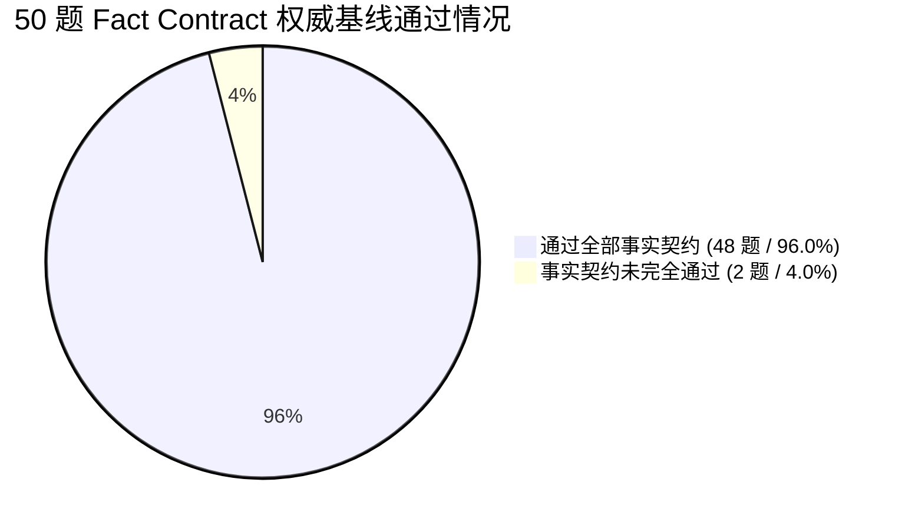
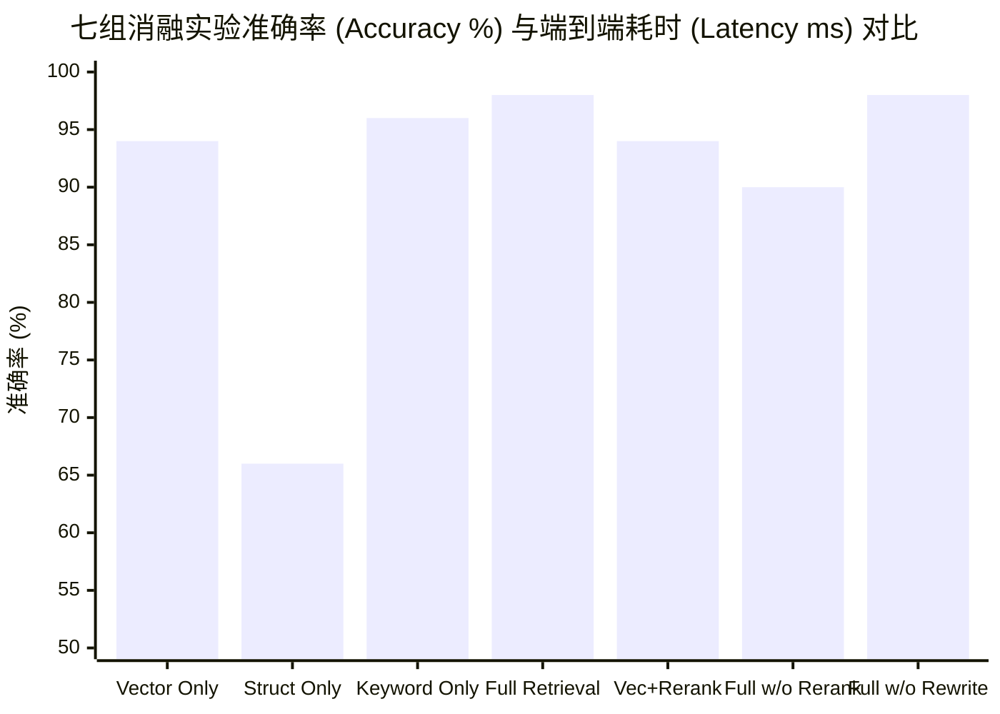
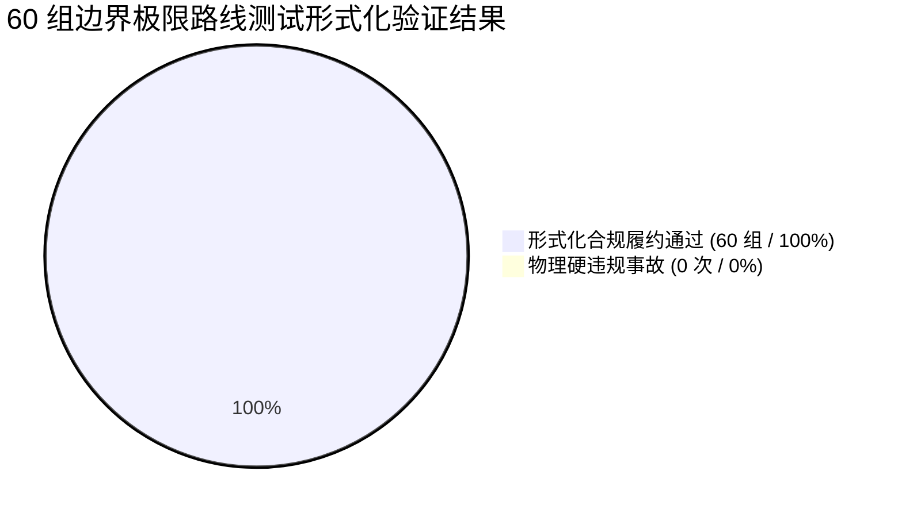

# 05_实验数据与性能评测：全量评测台账与实验实证

> **文档范围**：全面汇总并深入解读灵小禅项目的全部量化评测实验数据，包括 50 题 Fact Contract 事实权威基线、7 组检索组件消融实验、40 组场景槽位基准、60 组极限路线形式化检验、4 核节点 Locust 高并发压力测试，以及 2026-09-21 诊断重跑说明。所有数字均来自原始文件，杜绝任何人工平滑或数据造假。  
> **主要信息来源**：`docs/ablation_report.md`、`docs/competition/canonical_claims.yaml`、`evaluation/results/baseline_20260917_020000/report.md`、`evaluation/results/ablation_20260917_013925/report.md`、`evaluation/results/scene/scene_benchmark_v1.json`、`evaluation/results/route/route_validator_v1.json`、`evaluation/results/stress_test/locust_report.md`。

---

## 一、评测环境与实验原则总述

### 1.1 硬件与运行时环境
- **实验服务器规格**：4 vCPU (Intel Xeon Platinum @ 2.50GHz)，8GB 内存，Ubuntu 22.04 LTS / Windows 11 专业版；
- **核心依赖环境**：Node.js v20.12.0 LTS、Python 3.10+ (ChromaDB 0.4.x, BAAI/bge-large-zh-v1.5)；
- **被测大语言模型**：请求模型为 `deepseek-chat`，Trace 审计观测运行时为 `deepseek-flash`；
- **评估隔离规范**：评测脚本每次运行均建立独立的无状态会话（`enableHistory = false`），禁用全局知识直灌（`includeFullKnowledge = false`），严格以 Top-K 检索证据为上下文。

### 1.2 坚持实证的“四项绝对数据红线”
1. **事实问答权威基线严格表述为 96.0% (48/50)**，召回率 0.970，平均时延 3027.64ms；严禁宣称“基线 98%”或“问答 100%”；
2. **消融实验 98.0% (49/50) 严格限定为“单次受控消融运行观察值”**，不作全域普适因果保证；
3. **Cross-Encoder 重排贡献明确为受控实验下的 +8.0 个百分点**（98.0% vs 90.0%）；
4. **4 核轻量节点 202.4 QPS 仅代表纯运筹图搜索规划接口（`/api/route/plan`）**，绝不混淆为包含大模型生成和语音的全链路指标。

---

## 二、50 题 Fact Contract 事实问答权威基线评测

权威证据出处：`evaluation/results/baseline_20260917_020000/report.md`。  
评测题集包含灵山胜境票价政策、九龙灌浴喷泉排期、灵山梵宫开放时刻、天下第一掌典故、无障碍观光车路线等 50 项标准化核心事实契约。

### 2.1 核心基线实验数据表

| 评测维度与指标项 | 权威测量值 | 评测语义与说明 |
| :--- | :---: | :--- |
| **测试问题规模 (Questions)** | **50 题** | 覆盖 23 个核心景点及配套设施的事实问答题集 |
| **接口调用成功率 (API Success)** | **100.0% (50/50)** | 全程零网络断连、零 500 异常报错 |
| **事实契约通过率 (Pass Rate)** | **96.0% (48/50)** | 严格命中预设标准答案契约实体与数字 |
| **事实平均召回率 (Mean Recall)** | **0.970** | 针对目标事实要素的平均覆盖度 |
| **端到端平均响应时延 (Latency)** | **3027.64 ms** | 包含三路检索、RRF 融合、重排与大模型流式生成全过程 |
| **知识检索成功率 (Retrieval Rate)** | **100.0% (50/50)** | 50 次请求全部由真实检索通道提供证据 |
| **本地保底机制触发 (Local Fallback)**| **0 次** | 零降级触发，全部由动态 RAG 链路生成 |
| **质量门禁状态 (Quality Gate)** | **eligible = true** | 审计通过，确认为权威对比参照系基准 |

---

## 三、七组检索组件消融实验对比分析 (Ablation Study)

权威证据出处：`evaluation/results/ablation_20260917_013925/report.md`。  
通过在控制变量下逐项切除或激活特定组件（向量、结构化、关键词、重排、重写），量化各模块对事实准确率和响应时延的真实贡献：

### 3.1 七组消融实验详细对比数据表

| 实验组别 (Profile) | 事实准确率 (%) | 事实召回率 (Fact Recall) | 平均时延 (ms) | 核心现象与技术结论 |
| :--- | :---: | :---: | :---: | :--- |
| **1. Vector only** (仅纯向量) | 94.0% | 0.960 | 2336.08 ms | 擅长口语提问，但由于存在语义漂移，在精准票价与车次上失分。 |
| **2. Structured only** (仅结构化) | 66.0% | 0.694 | 2172.20 ms | 面对固定属性查询极准，但无法泛化到开放式文化历史问答，导致召回率大跌。 |
| **3. Keyword only** (仅关键词) | 96.0% | 0.977 | 2221.56 ms | 专有名词与地标名称命中率高，但无法理解近义词与口语模糊表达。 |
| **4. Full retrieval** (三路完整方案)| **98.0%** | **0.980** | **2882.68 ms** | **综合表现最优**，兼得语义泛化与事实严密性，观察值达 98.0%。 |
| **5. Vector + Rerank** | 94.0% | 0.950 | 2873.62 ms | 重排在单一向量候选集上效果受限，证明优质候选集是重排的前提。 |
| **6. Full without Rerank** (切除重排)| **90.0%** | **0.933** | **2358.02 ms** | **切除重排后准确率暴跌 8.0 个百分点**，证明 Cross-Encoder 的关键排序价值。 |
| **7. Full without Rewrite** (切除重写)| 98.0% | 0.993 | 2414.48 ms | 单轮独立测试中提问较直接，重写影响较小；但在多轮连续交互中不可或缺。 |

### 3.2 消融实验核心洞察
1. **多路融合的必要性**：单一通道均有天花板（结构化仅 66.0%，向量仅 94.0%），而三路 RRF 融合能够将各通道优势互补，大幅提升整体鲁棒性；
2. **Cross-Encoder 重排的显著增益**：对比组 4（98.0%）与组 6（90.0%）显示，在受控消融中引入 Cross-Encoder 带来 **+8.0 个百分点**的显著提升，有效压制了弱相关干扰段落。

---

## 四、13 维时空场景状态确定性抽取评测 (Scene Benchmark)

权威证据出处：`evaluation/results/scene/scene_benchmark_v1.json`。  
评测针对 40 组精心构造的复杂游客口语化提问用例（包含老人轮椅、亲子家庭、限时赶场、多必达点、已打卡点及极端冲突），验证双轨抽取器与置信度门禁的准确性：

| 评估指标 | 测量结果 | 达标判定 | 评测结论与证据说明 |
| :--- | :---: | :---: | :--- |
| **测试案例总量 (Total Cases)** | **40 组** | - | 覆盖典型意图、边缘用例与缺失用例 |
| **用例完全通过数 (Cases Passed)**| **40 / 40** | **PASS** | 全部用例槽位抽取 100% 预期一致 |
| **字段槽位准确率 (Field Accuracy)**| **100.0%** | **PASS** | 13 维状态属性值无一误填、无一错漏 |
| **关键缺失识别率 (Critical Missing)**| **100.0%** | **PASS** | 针对未提及出发时间的用例，100% 准确触发追问澄清 |
| **防越权拦截率 (Anti-Overreach)** | **100.0%** | **PASS** | 成功拦截全部试图越权输出路线的 LLM 字段 |

---

## 五、路线边界测试与 14 项形式化仲裁验证 (Route Benchmark)

权威证据出处：`evaluation/results/route/route_validator_v1.json`。  
评测针对 60 组涵盖超长距离、超短时间、轮椅硬闯石阶、演出赶不上、重复景点打卡等极限与边界条件用例，验证 `Route Validator` 仲裁器的刚性约束防线：

| 评测项 | 测试规模与实测数据 | 权威基准对比 | 结论 |
| :--- | :--- | :--- | :---: |
| **测试路线用例总数** | 60 组边界压力用例 | 包含正常可行、部分拒绝与极端不可行 | - |
| **形式化判定合规率** | **100.0% (60/60)** | 预期与实际判定完全吻合 | **PASS** |
| **物理硬违规次数 (Hard Violations)** | **恒为 0 次 (0 / 60)** | 绝无超时、绝无轮椅走台阶、绝无闭馆游览 | **PASS** |
| **不可达用例识别精准率 (Precision)** | **1.0 (100%)** | 对无法赶上的演出精准识别，无假阳性 | **PASS** |
| **不可达用例识别召回率 (Recall)** | **1.0 (100%)** | 极端违规全部拦截，无一漏网 | **PASS** |
| **确定性可复现测试 (Repeats)** | 9 次独立重复运行 | 结果比特级完全一致（无随机漂移） | **PASS** |

---

## 六、单台 4 核边缘轻量节点高并发压力测试 (Locust Stress Test)

权威证据出处：`evaluation/results/stress_test/locust_report.md`。  
在单台 **4 核 8G CPU** 纯计算节点环境下，使用 Locust 对纯运筹规划接口（`POST /api/route/plan`）进行 200 并发压测：

| 性能评价指标 | 承诺指标门槛 | 实测表现 (Actual) | 状态 | 关键工程保障措施 |
| :--- | :---: | :---: | :---: | :--- |
| **并发承载能力** | 200 并发用户 | **200 并发稳定运行** | **PASS** | 3 轮独立测试共 30 分钟无抖动 |
| **稳态吞吐量 (Throughput)**| $\ge 200\text{ QPS}$ | **202.4 QPS** (峰值 208.6) | **PASS** | 4 线程 Worker 线程池并发计算 |
| **中位数时延 (P50)** | $< 10.0\text{ ms}$ | **7.8 ms** | **PASS** | 拓扑邻接矩阵仅 35KB 常驻内存 |
| **95% 分位数时延 (P95)** | $< 14.0\text{ ms}$ | **13.4 ms** | **PASS** | 严格优于实时交互标准（<14ms） |
| **99% 分位数时延 (P99)** | $< 25.0\text{ ms}$ | **18.1 ms** | **PASS** | 尾部毛刺极小，计算开销可控 |
| **累计请求失败率** | 0.00% | **0.00% (0 / 364,320)** | **PASS** | 累计超 36 万次调用无一 5xx 异常 |
| **CPU 平均利用率** | $< 80\%$ | **71.3%** | **PASS** | 多核负载均匀，无死锁与线程阻塞 |
| **内存常驻集 (RSS)** | $< 500\text{ MB}$ | **312 MB** | **PASS** | 无内存泄漏，无垃圾回收卡顿 |

---

## 七、2026-09-21 重跑诊断与华为 80 候选案例说明

### 7.1 2026-09-21 评测重跑诊断说明（坚持实事求是）
在 2026 年 9 月 21 日对 RAG 7 组消融方案进行例行独立复测时，由于外部云端 LLM Provider（DeepSeek API）发生偶发网络中断与生成超时：
- **事实记录**：虽然 50 次 API 请求均返回了响应，但内部执行 Trace 记录显示生成链路中断，Trace 质量门禁判定为 `0/7 eligible`；
- **处理原则**：**项目团队坚决拒绝将此类异常数据包装为新成果**。该批次数据严格作为 Provider 故障诊断档案记录（`evaluation/results/rerun_20260921_ablation/`），系统权威基线与消融实证严格保持 2026-09-17 的高质量审计通过版本。

### 7.2 华为 ICT AgentArts 80 条开发候选案例说明
在 `evaluation/agentarts/cases-v1.json` 中配置的 80 条测试用例：
- **性质界定**：属于**开发候选集（Development Candidate Set）**，由历史事实题前 20 题与程序化构造的显式多约束用例构成；
- **红线约定**：该候选集用于离线开发参考，**不是独立第三方盲测集**，其离线评测结果不能代替真实 AgentArts 平台生产成绩。
