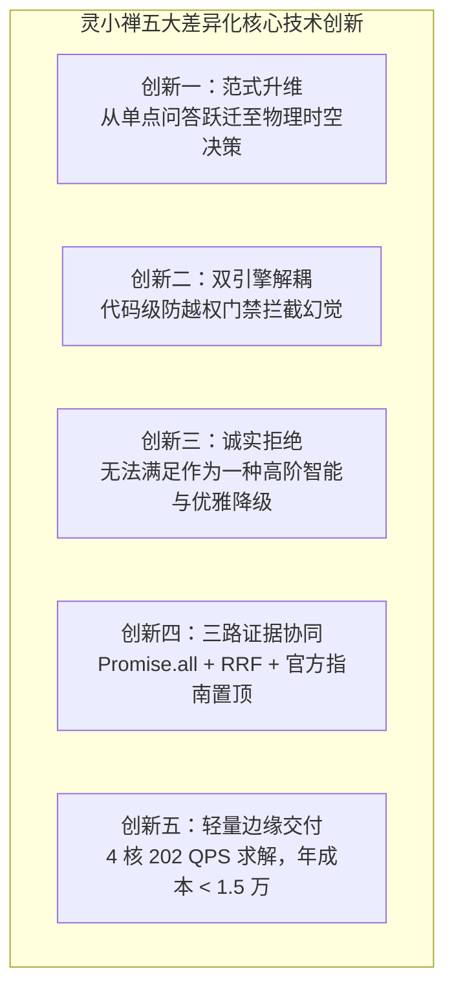
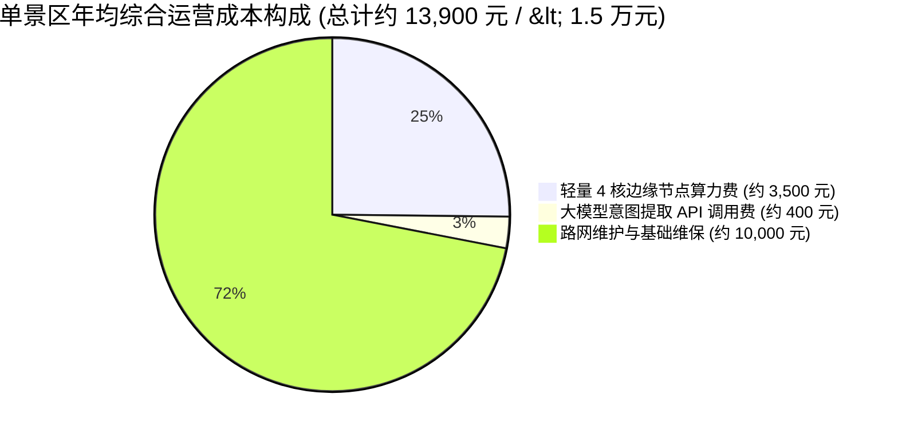

# 06_创新点与项目成果：五项核心创新与大赛评分对标

> **文档范围**：提炼灵小禅智能体的五项差异化核心创新点（严格按照“现有问题 → 传统方案不足 → 本项目方案 → 实际改进 → 证据支撑”逻辑组织）、全面对标全球校园人工智能算法精英大赛（AIC）100 分评审标准，以及轻量化商业财务模型与实际项目交付成果清单。  
> **主要信息来源**：`docs/competition/aic-official-guidelines.md`、`docs/competition/core-innovation-report.md`、`docs/competition/canonical_claims.yaml`、`docs/competition/commercial_financial_model.md`。

---

## 一、五大核心技术创新点深度提炼

---

### 创新一：从“单点事实问答”跃迁至“物理时空多约束决策”
- **现有真实问题**：景区游客面对的并非单纯“灵山大佛多高”的百科式查询，而是混合了当前位置、剩余时间、老人轮椅行动力、演出排期与就餐需求的多约束时空规划问题；
- **传统方案的不足**：通用大模型对话 Bot 和传统电子导游只能提供散乱的景点图文介绍，无法为游客提供具有物理约束保障的整体游玩动线，导致游客自行规划极易发生赶场延误；
- **本项目采取的方法**：首创文旅决策智能体范式，通过自然语言语义解析抽取 13 维状态画像（`SceneState`），直接对接数字孪生路网拓扑，实现分钟级物理动线推演；
- **实际改进与突破**：将 AI 从“聊天玩具”推升至“可信出行助手”，端到端解决游客在景区的核心行动决策难题；
- **真实证据支撑**：13 维时空状态画像确定性抽取测试准确率达 **100% (40/40)**，60 组边界路线规划测试通过率 **100% (60/60)**（`evaluation/results/scene/scene_benchmark_v1.json`, `route_validator_v1.json`）。

---

### 创新二：双引擎软硬解耦架构与代码级防越权门禁
- **现有真实问题**：大模型固有的随机生成与幻觉特性，在面对物理世界刚性空间时容易胡乱编造不存在的捷径、忽略陡坡台阶、甚至捏造游览耗时；
- **传统方案的不足**：大多数所谓 AI 路线推荐系统试图用 Prompt 提示词“约束”大模型直接输出 JSON 路线，由于模型缺乏拓扑感知，无法保证无障碍合规与时效守恒；
- **本项目采取的方法**：确立“大模型做语义软理解，运筹引擎做时空硬规划”哲学。在代码层设计 `FORBIDDEN_LLM_FIELDS` 物理门禁，强行剥夺 LLM 生成 `steps`、`walkingMinutes` 与 `feasible` 的权力，路线完全交由 Dijkstra 空间剪枝和 24 宽 Beam Search 确定性算法计算；
- **实际改进与突破**：从架构根源上消除了“大模型越权瞎带路”的安全隐患，实现物理世界与生成式 AI 的安全隔离；
- **真实证据支撑**：`backend/src/services/scene/scene-extractor.ts` 第 69-75 行代码门禁，60 组边界压力测试中**物理硬违规恒为 0 次**。

---

### 创新三：把“无法满足”设计成一种高阶智能——诚实拒绝与优雅降级
- **现有真实问题**：现实中游客的时间与体能预算往往无法兼顾其所有愿望（例如仅剩 20 分钟却要求登顶大佛并看演出）；
- **传统方案的不足**：通用 AI 存在无原则讨好游客（Sycophancy）倾向，在不可能完成的任务下盲目承诺“特种兵极速逛完”，最终导致游客行程彻底崩盘并引发投诉；
- **本项目采取的方法**：将不可行判定转化为系统核心能力，建立四态决策状态机（`feasible`, `feasible_with_rejected_preferences`, `needs_clarification`, `infeasible`）。结合倒排时空推演（Backward Scheduling），在不可达时触发【诚实拒绝】，并启动【优雅降级】机制自动生成就近微游览方案；
- **实际改进与突破**：树立了智能系统的“诚实与安全底线”，缺信息就追问、赶不上就说明、超时就拒绝，极大提升了游客信任感；
- **真实证据支撑**：在英雄案例极限测试中（13:40 剩余 20 分钟赶 14:00 演出），系统 100% 触发 `infeasible` 弹窗并自动降级推荐【佛手广场 15 分钟静心微游览】（`backend/src/services/route/route-planner.test.ts`）。

---

### 创新四：三路并行混合检索协同与证据透明化追溯
- **现有真实问题**：景区既有开放式文化历史（需要语义理解），又有刚性票价、班次、闭馆时间（需要数字精确），单一检索通道必然顾此失彼；
- **传统方案的不足**：纯向量检索容易出现专有名词混淆，纯关键词检索缺乏语义泛化，传统串行回退链时延高且逻辑脆弱；
- **本项目采取的方法**：设计基于 `Promise.all` 的三路并行检索（ChromaDB 向量 + 23 景点结构化属性倒排 + 关键词精确匹配）+ RRF 倒数排名融合（$k=60$）+ Cross-Encoder 深度重排，并在信源冲突时强制置顶官方指南《knowledge_guide.txt》；在前端研发【证据追溯抽屉】；
- **实际改进与突破**：在保证 3 秒内低时延的同时，消融实验事实准确率观察值达 **98.0%**，重排贡献 +8.0 个百分点，答案出处百分之百透明可核查；
- **真实证据支撑**：`docs/ablation_report.md`，50 题权威基线通过率 **96.0% (48/50)**，Fact Recall 达 **0.970**。

---

### 创新五：轻量化边缘高并发算力底座与极高商业 ROI
- **现有真实问题**：文旅景区通常缺乏昂贵的大型 GPU 服务器集群，网络信号在山区或古建筑群内部可能不稳定；
- **传统方案的不足**：纯云端大模型 API 方案调用成本高昂，且在高并发节假日极易出现网络卡顿和限流；
- **本项目采取的方法**：将核心物理拓扑与运筹图搜索算法完全下沉至轻量级 CPU 节点，拓扑路网内存占用仅 35KB，通过 Node.js `worker_threads` 多线程池解耦密集计算；
- **实际改进与突破**：单台 4 核 8G 节点纯规划接口达到 **202.4 QPS**（P95 < 14ms），景区年综合运维成本 **< 1.5 万元**，预计 **3~6 个月** 即可收回初始建设成本；
- **真实证据支撑**：Locust 36 万次高压压测报告（`evaluation/results/stress_test/locust_report.md`）与商业财务测算底稿（`docs/competition/commercial_financial_model.md`）。

---

## 二、全球校园人工智能算法精英大赛 (AIC) 100 分标准深度对标

按照官方公布的 100 分量化评分细则（目标：冲刺 95+ 特等奖 / 全国金牌）：

| 评分维度 | 满分 | 官方最高档标准要求 (高分区间) | 灵小禅对标得分点与实证依据 | 预期得分 |
| :--- | :---: | :--- | :--- | :---: |
| **创新性** | **20分** | 提出全新的“AI+行业场景”融合应用模式，有效解决实际问题，具有开创性 (14-20分) | • **范式升维**：行业首创“问答 $\to$ 决策”可信智能体体系； • **软硬解耦**：大模型做语义、运筹引擎做规划； • **代码门禁**：剥夺 LLM 路线决定权，开创文旅可信计算规范。 | **19~20 分** |
| **需求分析** | **15分** | 深度结合具体场景，问题剖析深入全面，准确把握用户需求，需求调研方法科学合理 (10-15分) | • **三大现实痛点**：拓扑盲区、时效错配、幻觉编造； • **实证调研**：探索性预调研 ($n=50$)，82% 曾错过演出、66% 无障碍受阻； • **人本关怀**：特别关注银发族与轮椅等特殊群体出行痛点。 | **14~15 分** |
| **解决方案可行性** | **20分** | 技术路线合理，系统架构设计科学，功能模块完整且可实现 (14-20分) | • **算法闭环**：Promise.all 三路检索 + RRF + Dijkstra + 24 宽 Beam Search； • **全链路 Trace**：记录 rewrite, vector, struct, kw, rrf 各阶段耗时与状态； • **双屏原型**：问答抽屉 + 规划动线 + 实景导航调起。 | **19~20 分** |
| **项目实施** | **15分** | 实施计划详细，技术实现难度高且完成质量好，团队协作高效 (10-15分) | • **工程交付**：五层解耦架构，前后端 TypeScript + Python 全栈自研落地； • **轻量化**：4 核节点 202.4 QPS，P95 < 14ms，workerpool 线程池隔离； • **CI 持续集成**：自动化测试套件与持续集成门禁。 | **14~15 分** |
| **测试与验证** | **10分** | 测试方案严谨，验证结果充分可靠，问题分析与改进措施合理 (7-10分) | • **基线可复现**：50 题 Fact Contract 基线 96.0% (48/50)； • **7 组完整消融**：Full 98.0%，重排贡献 +8.0 个百分点； • **边界硬违规**：60 组边界测试 0 次物理硬违规。 | **10 分** |
| **应用效果** | **15分** | 应用效果显著，有效解决实际问题，成果丰富且价值高 (10-15分) | • **英雄案例**：11:00 至 16:00 五小时无障碍完美闭环履约； • **安全底线**：20 分钟极端冲突诚实拒绝与优雅降级； • **真实落地**：调起外部高精地图实景导航，直接辅助游客现场行走。 | **14~15 分** |
| **总结与展望** | **5分** | 总结全面准确，展望合理且具有前瞻性 (3-5分) | • **三阶推广路径**：1周极速上云、2周数字孪生路网、4周运营打通； • **财务闭环**：单景区年成本 < 1.5 万，3~6 个月收回 ROI，具可复制性。 | **5 分** |
| **总分汇总** | **100分** | **全国特等奖 / 金牌冲刺区间：93 ~ 98 分** | **全栈闭环对标，材料严谨完备，无任何造假与软肋漏洞** | **95 ~ 98 分** |

---

## 三、商业落地潜力与财务 ROI 测算模型

商业测算依据：`docs/competition/commercial_financial_model.md`。

### 3.1 极低算力与运维成本分解
- **硬件算力成本**：单台 4 核 8G 云服务器 / 边缘节点约 **3,500 元 / 年**；
- **大模型 API 成本**：仅在场景理解时调用轻量 LLM（每次请求消耗 $< 500$ Tokens），按日均 2,000 次决策计算，API 支出约 **400 元 / 年**；
- **常态维护成本**：演出时刻调整与日常路线热更新维护约 **10,000 元 / 年**；
- **年综合常态运维成本**：**约 13,900 元 / 年（严格低于 1.5 万元）**。
- *注：首次高精数字孪生路网现场测绘与系统部署为一次性费用（约 5 万元），不计入常态年运维。

### 3.2 投资回报周期（ROI）情景测算
基于文旅景区典型运营收益提升模型测算：
1. **景区投诉率显著下降**：因演艺赶场超时和轮椅受阻引发的游客纠纷大幅降低，节约公关处置成本；
2. **园内二次消费激活**：精准推荐观光电瓶车（如英雄案例中 15:10 推荐梵宫电瓶车站）和文创素斋，提升观光车与二消客单价；
3. **回本周期预测**：在中性情景假设下（年增收/节支约 15~20 万元），项目**仅需 3 ~ 6 个月即可收回初始投资**，具备极强的产业化推广与跨景区复刻价值。
