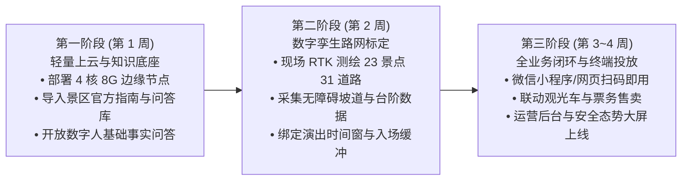

# 07_项目不足与未来规划：技术局限、风险与落地路径

> **文档范围**：秉持实事求是的学术竞赛与工程交付标准，坦诚梳理灵小禅智能体当前在数据测绘、平台集成、实验样本与安全系统方面的真实局限性，明确区分已知缺陷与潜在风险，并给出极具实操性的“三阶轻量落地推广路径”与下一阶段技术演进方向。  
> **主要信息来源**：`docs/competition/limitations.md`、`docs/competition/canonical_claims.yaml`、`AGENTS.md`、`docs/competition/huawei-ict/README.md`、`docs/skyguard/LIMITATIONS.md`。

---

## 一、系统当前客观存在的技术局限与事实说明

作为一个面向真实物理世界决策的原型系统，团队清醒认识到当前版本在软硬件环境、数据测绘粒度与实验规模上的边界，杜绝任何过度夸大与虚假承诺：

### 1. 数字孪生路网实测精度现状（待现场测绘补齐）
- **客观事实**：当前系统底座资产库（`data/route/`）共登记了 **23 个核心景点设施节点与 30 条道路边**；
- **局限披露**：当前代码库中所有道路边均带有 `confidence: "estimated"`（预估）标记，其物理米数与步行耗时由经纬度坐标与标准步速推算得出；代码模型中尚未建立现场实测的高精坡度（Slope Angle）连续物理场；
- **口径边界**：部分历史材料提及的“31 条道路”属于景区全连通的理想工程目标，当前第 31 条关键连通边仍在实地勘验核对中。在完成 RTK 高精测绘前，**不能将“已实现 31 条全量道路与高精坡度数字孪生”作为既成事实对外宣称**。

---

### 2. 华为 AgentArts 平台真实联调状态界定
- **客观事实**：系统已在本地完整落地了适配 AgentArts 规范的 5 个 HTTP 工具节点（`/api/v1/agentarts/tools/*`）、标准 OpenAPI 规范导出、Header API Key 校验门禁、以及后台运维调试面板；
- **局限披露**：目前开发团队尚未获得华为官方分配的线上生产工作空间（Workspace）与公网 HTTPS 部署域名；
- **边界说明**：
  - 本地参考编排脚本（`agentarts-local.ts`）与本地沙箱运行记录不能等同于 AgentArts 线上平台的原生工作流；
  - 80 条开发候选集测试仅用于离线契约验证，不可作为华为云平台性能指标发布。必须在获得真机环境后，方可出具官方联调凭证。

---

### 3. SkyGuard 应急疏散子系统的研究原型性质
- **客观事实**：SkyGuard 成功打通了“人群感知 $\to$ 风险评估 $\to$ 容量约束规划 $\to$ 15 类校验 $\to$ 四态状态机 $\to$ 大屏展示”的逻辑闭环；
- **局限披露**：
  - 所有疏散场景输入均为算法合成数据与模拟沙盘数据，未接入景区真实的安防监控 RTSP 视频流；
  - 华为昇腾（Ascend）CANN 硬件加速算子由于本地物理工控机缺乏 NPU 加速卡，未在真机上执行推理压测；
- **安全红线**：**SkyGuard 仅作为学术研究与技术演示原型，绝对不可直接用于真实景区的紧急疏散现场指挥！**

---

### 4. 离线评测集规模与真实游客极端多模态泛化
- **客观事实**：50 题 Fact Contract 事实基线（96.0%）、40 组场景槽位用例（100%）与 60 组路线边界用例（100% 合规）构成了高密度的验证体系；
- **局限披露**：上述评测集属于精心构建的标准受控评估集（Controlled Benchmark），尚未在数万名游客的复杂真实生产环境中接受大规模盲测（Wild Blind Test）；
- **潜在风险**：真实景区存在复杂的游客方言、大风呼啸下的语音杂音（ASR 衰减）、突发道路维修施工造成的临时断路等不可控现实因素，仍需在下一阶段通过实时动态图更新机制予以增强。

---

## 二、三阶轻量落地推广路径规划 (Rollout Roadmap)

为了推动灵小禅从“参赛原型”走向“行业标杆”，团队制定了清晰的“三阶轻量落地计划”，主打极低成本与敏捷实施：

### 第一阶段（第 1 周）：极速上云与知识底座冷启动
- **实施目标**：实现景区基础智能导览问答能力的秒级可用；
- **落地内容**：
  1. 在单台轻量级服务器（4 核 8G）通过 Docker 一键部署后端服务；
  2. 导入景区现有文本与表格文档，自动分块生成 BGE 向量索引与结构化二级索引；
  3. 游客端微信扫码即可开启与“灵小禅”的 Live2D 拟人文化互动，快速解决 90% 的基础咨询。

### 第二阶段（第 2 周）：数字孪生路网拓扑高精标定
- **实施目标**：为景区注入物理刚性决策基因；
- **落地内容**：
  1. 工程师手持差分 GPS/RTK 测绘仪，实地采集 23 个景点与 31 条主要道路的实际物理米数、坡度阻抗与台阶分界；
  2. 录入景区观光电瓶车站台、轮椅升降机与医务室等无障碍设施坐标；
  3. 固化每日演出时刻表与安检排队前置缓冲窗口（15~20 分钟），完成运筹引擎与 14 项形式化验证器的现场校准。

### 第三阶段（第 3~4 周）：全场景业务闭环与全域终端打通
- **实施目标**：激活商业变现闭环与全域客流管控；
- **落地内容**：
  1. 与景区微信小程序、扫码打卡牌、AR 实体导览大屏完成 UI 适配；
  2. 对接景区观光车票务核销系统，在游客动线推荐中实现车票即时引导；
  3. 运营管理后台（SentimentReportPage）交付景区宣教与安防部门，开始常态化客流热点监控与情感预警。

---

## 三、下一阶段核心技术演进方向

1. **多智能体协同客流宏观平衡 (Multi-Agent Macro Balancing)**：
   - 当前系统主要优化单名游客或单个家庭的局部最优动线；
   - 下一阶段将引入中心协调智能体（Coordinator Agent），根据景区全域实时热力图，动态向不同游客推荐错峰游览路线，实现景区空间的全局均衡负载，杜绝核心场馆局部拥堵；
2. **多模态空间感知与 AR 实景沉浸导航 (Spatial AR Navigation)**：
   - 结合手机摄像头与视觉大模型（Vision LLM），实现“所见即讲解”；
   - 游客将摄像头对准建筑或石雕，系统自动识别纹样与佛学典故，并在屏幕上叠加虚实融合的无障碍坡道导引箭头；
3. **现场动态突发事件增量图纠偏 (Dynamic Graph Incremental Repair)**：
   - 当遇到路段临时维保、降雨湿滑封闭时，运营人员在后台点击一键断路，系统自动向全域游客推送增量微重规划（Reroute），在 1 秒内无感切换绕行路径。
