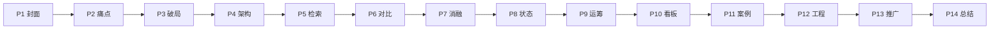

# 08_PPT制作素材：14页金牌叙事分镜、视觉资产与答辩攻防

> **文档范围**：专为项目路演汇报 PPT 制作、设计排版以及全国总决赛现场答辩讲稿量身打造。完整提供标准的 14 页金牌叙事结构（P1~P14 逐页规划）、视觉图表选型与路径索引、3~5 个顶级核心亮点、5 个评委高频尖锐提问与防守话术矩阵。  
> **主要信息来源**：`竞赛汇报与文档材料包/01_汇报PPT与导出版/14页高保真分镜设计稿与排版指南_optimized.md`、`00_交接必读_PPT与文档制作指南.md`、`docs/competition/canonical_claims.yaml`、`docs/competition/core-innovation-report.md`。

---

## 一、演示汇报全景叙事逻辑 (Presentation Narrative Arc)

答辩汇报必须遵循“**起承转合、环环相扣**”的黄金 14 页叙事链条，绝不可罗列杂乱的代码模块：

```text
[痛点起势] P1 封面立意 → P2 行业三大痛点 (翻车常态) → P3 核心范式升维 (破局之道)
    ↓
[架构与技术] P4 全景五层架构 → P5 三路混合检索机制 → P6 检索对比盲区 → P7 七组消融实证
    ↓
[状态与运筹] P8 13维状态理解与门禁 → P9 确定性物理拓扑运筹 → P10 适老与时空专项看板
    ↓
[成果与收官] P11 英雄案例时空还原 → P12 工程交付与数字人原型 → P13 极低成本推广价值 → P14 总结收官
```

---

## 二、14 页金牌标准版 PPT 逐页设计规划方案



### P1 封面页：立意升维
- **主标题**：**灵小禅 · 灵山胜境可信文旅决策智能体**
- **副标题**：面向真实景区的可信文旅决策智能体：从单点事实问答到物理时空多约束规划
- **本页核心观点**：文旅 AI 的价值不在于背百科，而在于为游客作出安全、可行的真实物理世界决策。
- **视觉素材建议**：全屏高清国风科技背景图（`竞赛汇报与文档材料包/02_图片与视觉素材/国风数智_灵山胜境概念大图(封面推荐).jpg`）。
- **演讲要点**：评委老师好！今天我们带来的作品不是一个简单的景点聊天问答机，而是一个真正懂老人轮椅、会看地图算时间、绝不瞎带路的可信文旅决策智能体——灵小禅。

---

### P2 痛点页：为什么市面上的文旅 AI 导览“中看不中用”？
- **核心观点**：传统 AI 导游存在三大现实翻车盲区，导致游客体验割裂甚至引发安全隐患。
- **展示内容**：
  1. **空间拓扑盲区**：缺乏米数与坡度概念，盲目引导轮椅老人硬爬百级陡峭台阶；
  2. **时效冲突盲区**：只知演出几点开场，忽略入场排队安检缓冲，导致游客赶场吃闭门羹；
  3. **事实幻觉盲区**：缺少官方指南置顶，虚构票价或过度迎合编造不可行的极端路线。
- **关键数据**：**探索性预调研 ($n=50$) 显示**：**82%** 曾因赶场错失演出，**66%** 曾遭遇台阶阻断被迫折返，**74%** 曾受通用 AI 幻觉误导。
- **视觉组件**：三张警告色（红/金/蓝）卡片并列，搭配探索性预调研饼图。
- **逻辑承接**：面对这三大致命痛点，修修补补 Prompt 已经失效，必须从底层逻辑进行范式升维。

---

### P3 破局页：核心升维——从“单点事实问答”跃迁至“物理时空决策”
- **核心观点**：软硬解耦，将生成式 AI 的自然语言温度与运筹学的物理刚性执行力完美融合。
- **展示内容**：对比条直观展示两种范式的鸿沟：
  - **传统 AI（回答事实）**：查百科/查票价 $\to$ 概率自回归，数字错漏只是口误；
  - **灵小禅（辅助决策）**：算路线/算时间 $\to$ 物理刚性约束，算错一步就是安全事故！
- **三大破局支柱**：
  - **知景区**：多路混合检索攻克文旅“事实盲区”；
  - **懂游客**：13 维时空状态画像攻克“意图盲区”；
  - **定行程**：确定性运筹规划攻克“路线能不能走通”。
- **视觉组件**：左侧对比表格 + 右侧三大破局三角支柱卡片。

---

### P4 架构页：五层解耦与软硬协同架构图
- **核心观点**：建立覆盖“问—懂—查—规划—交互”的端到端工程闭环，代码级防越权门禁守护底线。
- **展示内容**：
  - 表现层（双屏分流：QAPage 问答抽屉 + RecommendPage 规划看板 + Live2D 数字人）；
  - 规划层（Dijkstra 无障碍剪枝 + 24 宽 Beam Search 启发式搜索）；
  - 知识层（Promise.all 三路混合检索 + RRF $k=60$ + 官方指南兜底）；
  - 状态层（13 维状态画像双轨抽取 + 倒排时空推演 + 防越权门禁）；
  - 底座层（14 项形式化守恒仲裁器 + 全链路 Trace 审计）。
- **视觉素材**：清晰的五层架构泳道图（直接采用原生圆角卡片布局）。
- **逻辑承接**：架构的核心首先在于“底座知识准不准”，接下来看知识层的检索机制。

---

### P5 检索页：多路协同混合检索与证据全息追溯
- **核心观点**：通过 `Promise.all` 三路并发与 RRF 融合，彻底消灭单一检索模式的信息死角。
- **展示内容**：
  - **向量检索**：BGE-large-zh 提取深层语义，处理口语化典故；
  - **结构化索引**：23 景点 $\times$ 8 属性二级索引，秒级查询固定演出与票价；
  - **关键词检索**：倒排精确匹配专有名词与编号；
  - **RRF 融合算子**：$k=60$ 倒数排名融合，保证无偏排序；
  - **官方指南兜底**：《knowledge_guide.txt》最高优先级置顶，裁决信源冲突。
- **视觉组件**：三列并排输入卡片 $\to$ 汇聚至 RRF 漏斗算子 $\to$ 输出事实卡片。

---

### P6 对比页：单一检索存在盲区，多路协同实现事实与泛化兼得
- **核心观点**：实测证明，没有任何单一检索能够独自胜任文旅复杂问答。
- **展示内容**：4 行实测对比表：
  - 查询演出时刻：结构化索引准确率 100%，纯向量仅 70%；
  - 查询车次编号：关键词匹配 100%，纯向量语义漂移；
  - 查询历史传说：纯向量准确率 95%，关键词 0 命中；
  - 信源冲突裁决：以官方权威指南为准，杜绝网上过时营销软文。
- **视觉组件**：四行对比雷达卡片，突出多路协同的均衡性。

---

### P7 消融页：消融实验量化贡献——三路全检索观察值达 98.0%
- **核心观点**：受控实验证实各组件的刚性贡献，Cross-Encoder 重排带来 8 个百分点飞跃。
- **关键数据**：
  - 50 题 Fact Contract 权威基线：**96.0% (48/50)**，Recall 0.970，时延 3027ms；
  - 7 组消融完整方案受控观察值：**98.0% (49/50)**；
  - 切除重排（Full w/o Rerank）：准确率降至 **90.0%**（**重排增益 +8.0%**）；
  - 单一结构化仅 **66.0%**，单一向量 **94.0%**。
- **视觉素材**：**PPT 原生簇状柱状图**（展示 7 组消融实验准确率对比）。
- **逻辑承接**：事实检索解决后，如何把游客自然语言提问转化为数学规划输入？

---

### P8 状态页：游客状态深度理解——听懂难处，代码级防越权
- **核心观点**：13 维画像精准提取，倒排逆推时空约束，代码门禁拦截大模型越权瞎带路。
- **展示内容**：
  - **13 维画像**：行动能力（轮椅/老人）、游览预算、必达景点、演出偏好；
  - **倒排逆推 (Backward Scheduling)**：死线 14:20 演出结束 $\to$ 自动逆推当前出发时刻 11:00；
  - **代码防越权拦截**：`FORBIDDEN_LLM_FIELDS` 强行剥夺 LLM 输出路线 `steps` 权限；
  - **置信度门禁**：阈值 $\ge 0.75$，关键信息缺失主动追问。
- **关键数据**：40 组场景槽位测试准确率 **100.0% (40/40)**，关键缺失识别率 100%。
- **视觉组件**：游客口语输入 $\to$ 提取状态 JSON $\to$ 盾牌拦截门禁图示。

---

### P9 运筹页：确定性物理拓扑规划——确保路线“真实走得通”
- **核心观点**：运筹规划接管决策，Dijkstra 空间剪枝 + Beam Search 时空搜索，守护物理底线。
- **展示内容**：
  - **数字孪生路网**：23 个景点设施节点 + 30 条当前登记连通道路边（31 条目标口径待测绘核验）；
  - **Dijkstra 剪枝**：识别轮椅标签，瞬间过滤所有台阶与陡坡边；
  - **24 宽 Beam Search**：多目标时空搜索，前置强制预留 15~20 分钟演艺入场缓冲；
  - **14 项形式化验证**：Route Validator 纯函数审查时间与拓扑守恒；
  - **诚实拒绝与优雅降级**：赶不上演出时，自动重算纯游览备选路线，绝不敷衍游客。
- **关键数据**：60 组边界压力路线测试，**物理硬违规恒为 0 次**！
- **视觉素材**：算法拓扑图示（`01_Dijkstra_Algorithm_CC0.png`, `02_Beam_Search_D2L.svg`）。

---

### P10 看板页：适老关怀与时空专项看板
- **核心观点**：专项解决银发族与脆弱群体出行难，打造真正有温度的人本科技。
- **展示内容**：
  - 智能识别“推轮椅/老人步速”，自动将步速降至 0.8m/s 计算；
  - 全程动态监测爬坡负荷，在动线中强制插入平缓步道与电瓶车换乘点；
  - 演艺缓冲策略：通用 15~20 分钟缓冲，预留穿戴鞋套与安检时间。
- **视觉组件**：左侧轮椅无障碍通行动线卡片，右侧演艺时间窗对齐图示。

---

### P11 案例页：英雄案例时空还原——五小时无障碍完美履约
- **核心观点**：实测跑通经典复杂用例，所见即所得，支持一键调起外部实景导航。
- **案例设定**：*“带轮椅老人，南门出发，限时 300 分钟 (5小时)，必看 14:00《吉祥颂》”*
- **唯一权威履约时间线**（严格对齐 FACT-12）：
  - **11:00** 景区正门出发（无障碍通道，途经大照壁、五明桥、佛足坛）；
  - **11:50~12:20** 九龙灌浴（广场祈福与观看演出，预留 10 分钟占位缓冲）；
  - **12:30** 拍照延误 10 分钟后，动态微纠偏压缩非核心林道漫步；
  - **13:40** 灵山梵宫检票口（**提前 20 分钟到达**，穿鞋套与排队）；
  - **14:00~14:20** 灵山梵宫剧场（完整观看《吉祥颂》）；
  - **15:10** 梵宫电瓶车站乘坐无障碍电瓶车直达佛手广场；
  - **16:00** 准时返回正门，总耗时 300 分钟，零违规安全履约！
- **极限冲突对比**：若游客 13:40 仅剩 20 分钟要求去大佛并看演出，系统**诚实拒绝并优雅降级为佛手广场微游览**。
- **视觉素材**：`竞赛汇报与文档材料包/02_图片与视觉素材/国风数智_游客多约束决策全景概念图.jpg`。

---

### P12 工程页：产品工程闭环——双屏分流、Live2D 与边缘节点
- **核心观点**：拒绝纯云端玩具，端到端高可用工程交付，极致边缘计算性能。
- **展示内容**：
  - **双屏分流前端**：问答页配备【证据追溯抽屉】（出处/相似度/时延）；规划页支持【调起高德/百度实景导航】；
  - **汉服数字人原型**：Live2D 情绪驱动（倾听/欢喜/致歉/关切）与唇形同步；
  - **轻量边缘算力**：纯规划接口在 4 核 8G 节点实测达到 **202.4 QPS**（P95 = 13.4ms，0 错误率）；
  - **管理运营后台**：知识库动态切块热更新、情感预警审计看板。
- **视觉素材**：数字人立绘大图（`国风数智_灵小禅全新立绘概念图.jpg`）+ 双屏 UI 截图。

---

### P13 推广页：极低成本、快速部署与显著商业 ROI
- **核心观点**：年综合算力与运维成本低于 1.5 万元，三阶敏捷推广，具备高复制性。
- **展示内容**：
  - **极低运维成本**：单景区 4 核节点算力 ~3500 元/年，意图抽取 API ~400 元/年，年运维总成本 **< 1.5 万元**；
  - **投资回报测算**：情景模型测算预计 **3~6 个月** 收回初始部署成本；
  - **三阶轻量落地**：第 1 周极速上云、第 2 周路网测绘标定、第 4 周全域终端业务打通；
  - **跨空间泛化**：可低成本迁移至文博展馆、主题乐园与工业园区。
- **视觉素材**：跨空间迁移拓扑图（`国风数智_跨文旅空间数智迁移拓扑图.jpg`）+ 成本构成饼图。

---

### P14 总结页：总结收官——让每一位游客的文旅决策安全可信
- **核心观点**：软硬解耦、守正创新，树立真实物理世界 AI 决策智能体新标杆。
- **展示内容**：
  - 核心贡献总结：1 项新范式、双引擎解耦架构、三路 RRF 融合、14 项形式化验证底线；
  - 一句话金句：**“大模型赋予技术以温度，运筹学守护物理以底线。灵小禅让每一次文旅出行，都成为心中有数的美好旅程！”**
- **致谢信息**：参赛团队信息、开源仓库链接、恳请各位评委专家批评指正！

---

## 三、现场答辩五大尖锐技术问题攻防对策矩阵 (Defense Q&A)

### 追问 1：为什么不直接用 GPT-4 或 DeepSeek 配合复杂的 Prompt 让大模型直接输出路线？
- **回答要点**：
  1. **物理不可达的本质**：大模型本质是基于词元概率自回归生成，无法建立空间绝对欧几里得距离与图连通拓扑，Prompt 无论如何优化，在长链路多约束下必定发生数学违规或时间算错；
  2. **安全责任不可让渡**：如果大模型把轮椅游客引导去爬陡坡台阶，在旅游运营中属于严重安全事故。我们通过 `FORBIDDEN_LLM_FIELDS` 剥夺大模型决定路线的权力，交给确定性图算法求解，这是对游客安全的敬畏与工程底线。

### 追问 2：你们如何保证轮椅游客绝对不会被引导到台阶或陡坡上？
- **回答要点**：
  1. **子图物理隔离**：规划层第一步是在全图上执行 Dijkstra 空间剪枝，若识别到 `wheelchair` 标签，所有 `accessible == false` 的边被直接物理切除，算法在内存中根本“看不到”台阶边；
  2. **双重防线兜底**：即便规划算法发生异常，后置的 `Route Validator` 仲裁器会以纯函数对动线每一步执行硬约束审查，发现不合规边直接判违规拦截。60 组极限用例实测物理硬违规恒为 0。

### 追问 3：如果游客在路上拍照延误了 15 分钟，系统如何处理？
- **回答要点**：
  1. **动态增量微重规划 (Reroute)**：系统支持在已有状态上注入当前滞后时间。当超时 $> 10$ 分钟时，规划引擎会以游客当前坐标为新起点重新触发 Beam Search；
  2. **智能压缩弹性时间**：优先压缩非核心景点的漫步停留时间；若发现无论如何已赶不上 14:00 演出，系统绝不让游客继续狂奔，而是触发优雅降级，推荐调整为下午后续场次或就近微游览。

### 追问 4：你们在 PPT 中提到的 96.0% 基线和 98.0% 消融实验有什么区别？
- **回答要点**：
  1. **严守学术规范，拒绝混淆口径**：**96.0% (48/50)** 是我们正式冻结的 Fact Contract 50 题权威基线通过率，包含严格的端到端质量门禁审计；
  2. **消融实验定位**：**98.0%** 是在受控消融实验中，完整方案在特定单次运行中观察到的测量值。我们如实将两者分别记录在评测报告中，以此印证 Cross-Encoder 重排带来的 +8.0 个百分点显著提升，绝不为了好看而人为合并或虚报。

### 追问 5：景区引入这套系统的真实门槛和成本是多少？
- **回答要点**：
  1. **无需昂贵 GPU**：核心拓扑路网内存占用仅 35KB，4 核轻量节点即可支撑 202.4 QPS 拓扑求解；
  2. **年化支出极低**：单景区年综合算力与维保成本低于 1.5 万元；在 1~2 周内通过手持差分 GPS 即可完成路网数字化标定，3~6 个月即可通过观光车二消和降低投诉收回投资。
